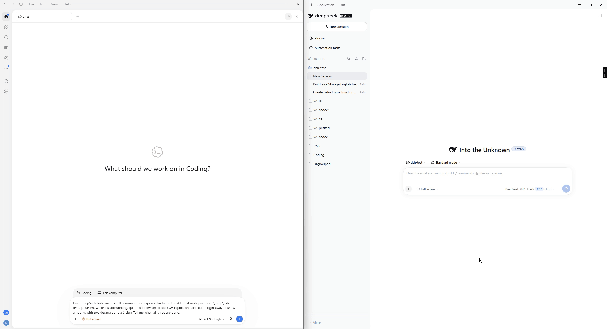
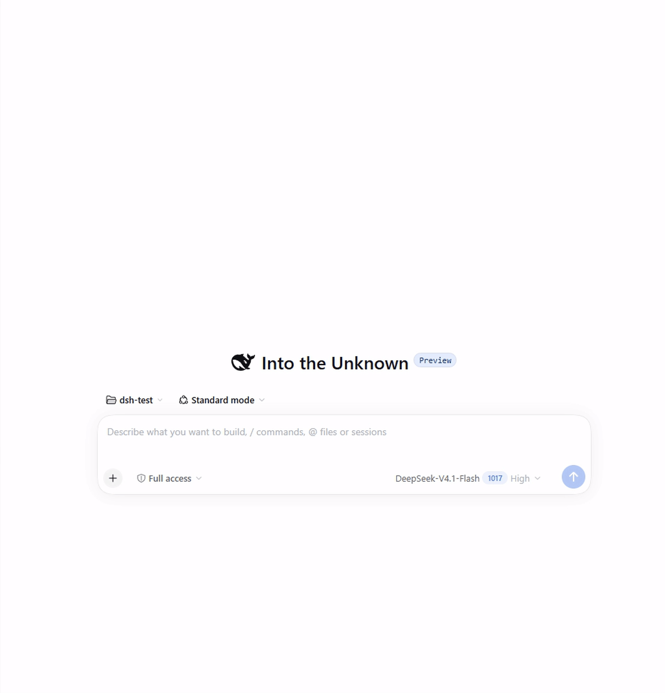

<p align="center">
  
</p>

<p align="center">
  English | <a href="README.zh-CN.md">中文</a> · Unofficial; not affiliated with DeepSeek.
</p>

<p align="center">
  macOS · Windows (<a href="WINDOWS.md">guide</a>) · Node.js ≥ 22.15 · zero dependencies · MIT
</p>

<p align="center">
  
</p>

<p align="center">
  
</p>

## See it run

One Codex chat starts a task, queues a follow-up, steers the running turn, and waits for all three:

<p align="center">
  
</p>

Codex and Claude take turns in the same Harness session, and every message is labelled with who sent it:

<p align="center">
  
</p>

<p align="center"><a href="docs/demos.md">More demos →</a></p>

## Quick start

<p align="center">
  
</p>

Requires DeepSeek Harness ≥ 0.2.1-rc.2 (signed in), Node.js ≥ 22.15. On Windows, see [WINDOWS.md](WINDOWS.md).

**1. Run setup** in a terminal:

```bash
npx -y dsh-baton-mcp setup
```

dsh-baton has no dependencies. `setup` copies itself to `~/.dsh-baton/app`, a folder that stays put (npx's cache does not), and registers the MCP server once, user-wide, for Claude Code and Codex: every new conversation, in any folder, has the `dsh_*` tools. It writes `~/.claude.json` and `~/.codex/config.toml` directly (a backup of each is kept as `*.bak-dsh-baton`), so it also works when only the desktop apps are installed and `claude` / `codex` are not on your `PATH`. Running it again is safe.

**2. Paste in Harness.** `setup` copies the plugin folder path to your clipboard:

**Plugins** (插件) → **Add plugin** (添加插件) → paste → **Install** (安装) → **Enable now** (立即启用)

**3. Check.** Start a **new** conversation in Claude Code or Codex and ask it to call `dsh_list_workspaces`. It lists your Harness workspaces.

**Or let Claude Code or Codex do it:** paste *"Run `npx -y dsh-baton-mcp setup`, then tell me the Harness step it prints."*

**How each client waits** (nothing to configure):
- **Claude Code** waits for a run in the background (the `wait_command` that `dsh_send` returns) and is woken once, when the run ends.
- **Codex** waits inside `dsh_wait`, up to 270 s per call, just under its 300 s tool timeout. An unfinished wait returns only the state, so Codex calls again without summarising. Codex gets no `wait_command`: its terminal cannot wake it, so it would poll.
- Codex asks you to approve MCP tool calls: approve the `dsh-baton` tools. For unattended `codex exec` runs, add `--approve-for-me`.

**Updating:** run `npx -y dsh-baton-mcp@latest setup` again, then restart Harness to load plugin changes; new conversations pick up MCP server changes.

**Removing:** `npx -y dsh-baton-mcp setup --remove`, then Harness → Plugins → dsh-baton-host → Uninstall, then `setup --remove` once more to delete `~/.dsh-baton/app`.

**Upgrading from dsh-bridge**: run `setup` as above. It replaces the old `dsh-bridge` MCP entries; in Harness, uninstall `dsh-bridge-host`, then add the new path. `DSH_BRIDGE_*` variables and an existing `~/.dsh-bridge` folder keep working for now. Tools get a new prefix (`mcp__dsh-baton__…`), so update any permission allowlists.

**From source** (to follow `main` or to change the code): `git clone https://github.com/JialaoLiu/dsh-baton.git` and `node dsh-baton/src/cli.mjs setup`. setup then registers the clone itself; update with `git pull`.

<details>
<summary>Manual registration and the Claude desktop app</summary>

`setup` writes the same entries these commands would (with the absolute path of `node`, since desktop apps start MCP servers without your shell's `PATH`):

```bash
claude mcp add dsh-baton -s user -- "$(command -v node)" "$PWD/dsh-baton/src/server.mjs"
codex mcp add dsh-baton -- "$(command -v node)" "$PWD/dsh-baton/src/server.mjs"
```

`-s user` matters: without it, Claude Code registers the server for the current project folder only.

**Claude desktop app (optional)**: for the chat app's connectors (separate from Claude Code), add this to `~/Library/Application Support/Claude/claude_desktop_config.json` and restart the app. It shows as a "Local dev" connector.

```json
{ "mcpServers": { "dsh-baton": { "command": "/absolute/path/to/node", "args": ["/absolute/path/to/dsh-baton/src/server.mjs"] } } }
```

</details>

## How it works

<p align="center">
  
</p>

<p align="center">
  
</p>

## Tools

<p align="center">
  
</p>

<p align="center">
  
</p>

<details>
<summary>Full tool reference</summary>

| Tool | What it does |
|---|---|
| `dsh_list_workspaces` | Workspaces in the Harness sidebar |
| `dsh_create_workspace` | Register a folder as a workspace (creates the folder if missing); returns the existing one if already registered |
| `dsh_list_sessions` | Sessions newest first, with title, folder and running state; filter by folder or text. Archived sessions are left out |
| `dsh_read_session` | Recent prompts and replies of one session (with tool names); `archived: true` for an archived session |
| `dsh_send` | Send a message: `session_id` continues that session; `cwd` or `workspace_id` starts a new one (a `cwd` that is not a workspace yet is registered first). Returns a `run_id` at once. In Harness the message is marked "Sent by Claude / ChatGPT from another chat". An archived session is refused: unarchive it in Harness, or start a new session |
| `dsh_status` | Run progress: state, recent text and tool calls, final reply; `waiting_on` when the turn is over but sub-agents or jobs still run; `human_interjections` when someone typed in the Harness UI mid-run; state `interrupted` for a run cut short by a Harness restart |
| `dsh_wait` | Wait for the run to end: up to 270 s per call for Codex, 50 s for other clients. Still going: returns `timed_out` with just the state; call it again. Clients that can wait in the background use `dsh_send`'s `wait_command` instead. `dsh_status` is a one-off look, not a way to wait |
| `dsh_session_activity` | What a session is doing now: running turn, sub-agents (any depth), background jobs; `archived: true` for an archived session |
| `dsh_cancel` | Stop everything a session is doing, by `run_id` or `session_id`: turn, sub-agents, jobs (queued messages stay) |
| `dsh_rename_session` | Rename a session |
| `dsh_rename_workspace` | Rename a workspace (sidebar title only; the folder is not moved) |
| `dsh_list_runs` | Recent runs |

</details>

## CLI

```bash
dsh-baton workspaces
dsh-baton new-workspace ~/code/new-app --title "New App"
dsh-baton sessions --cwd ~/code/new-app
dsh-baton send --cwd ~/code/new-app "Scaffold the project"
dsh-baton send --session session-xxxx "Next: add tests"
dsh-baton send --session session-xxxx --mode steer "Interjection: don't change the API"
dsh-baton wait hrun-xxxx              # blocks, prints the final reply; exit 0 on success
dsh-baton status hrun-xxxx
dsh-baton activity session-xxxx       # running turn, sub-agents, background jobs
dsh-baton cancel --session session-xxxx
dsh-baton rename session-xxxx "New title"
dsh-baton rename-workspace ~/code/new-app "New name"
```

## Configuration

| Variable | Default | Meaning |
|---|---|---|
| `DSH_BATON_BACKEND` | `auto` | `auto`, `host` or `headless` |
| `DSH_BATON_HOME` | `~/.dsh-baton` | Socket and headless run records |
| `DSH_BATON_SOCKET` | `$DSH_BATON_HOME/host.sock` | Plugin socket path (must match on both sides); on Windows mapped to a per-user named pipe |
| `DSH_BATON_WAIT_S` | `270` for Codex, else `50` | How long one `dsh_wait` call waits; set it only if you raised the client's tool timeout, and keep it below that |
| `DSH_BIN` | the `dsh` inside the macOS app, else `PATH` | Harness CLI for headless mode |
| `DSH_HOME` | `~/.dsh` | Harness data folder (headless session reads) |
| `DSH_BATON_ACCOUNT` | `1` | `0` uses the API-key route in headless mode |
| `DSH_BATON_PATCHES` | empty | Extra headless `--patch` overlays, `:`-separated |

<details>
<summary>Headless fallback details</summary>

When the plugin is unreachable, the MCP server falls back to Harness's `dsh headless` command. It can only continue sessions it created itself (headless does not load agent presets such as `standard`), and new sessions do not appear in the desktop sidebar. By default [`patches/account.patch.yml`](patches/account.patch.yml) reuses the desktop app's DeepSeek account sign-in, so no API key is needed.

</details>

## Security and limits

<p align="center">
  
</p>

<p align="center">
  
</p>

Any process running as your OS user can drive Harness through the socket, the same as running `dsh` directly. dsh-baton relies on Harness 0.2.1-series internal service APIs, so a major Harness update may need a follow-up release.

<p align="center"><a href="docs/demos.md">More demos →</a></p>

## License

MIT
