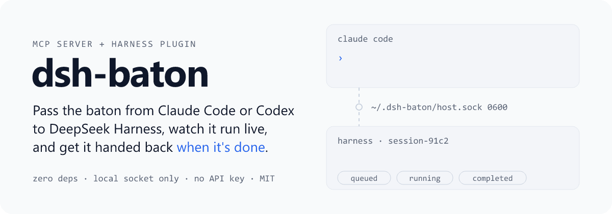
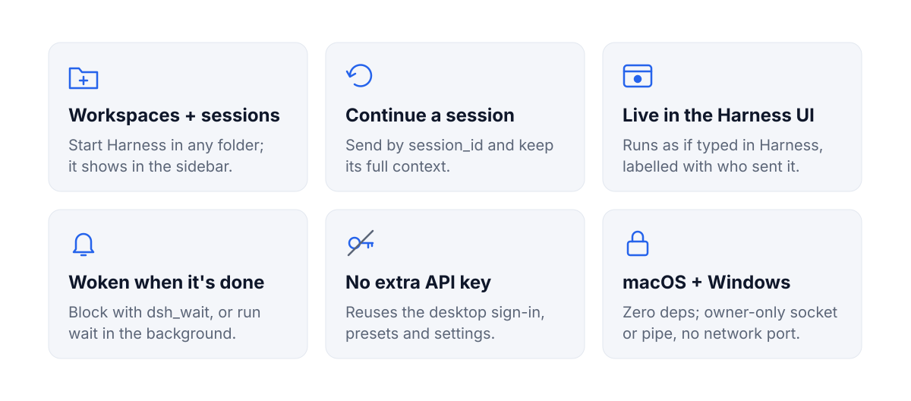
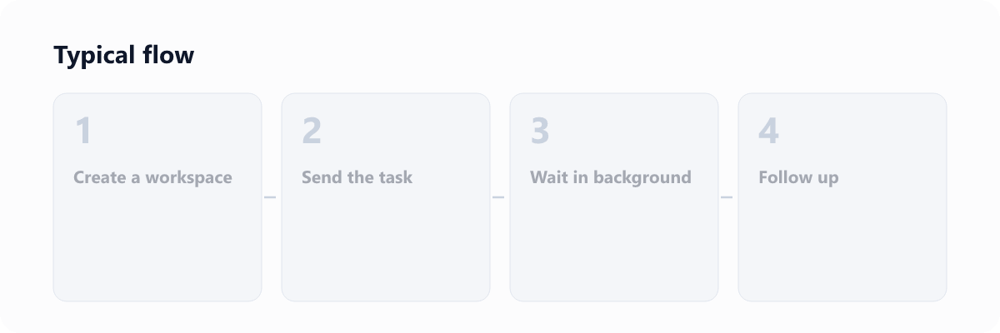
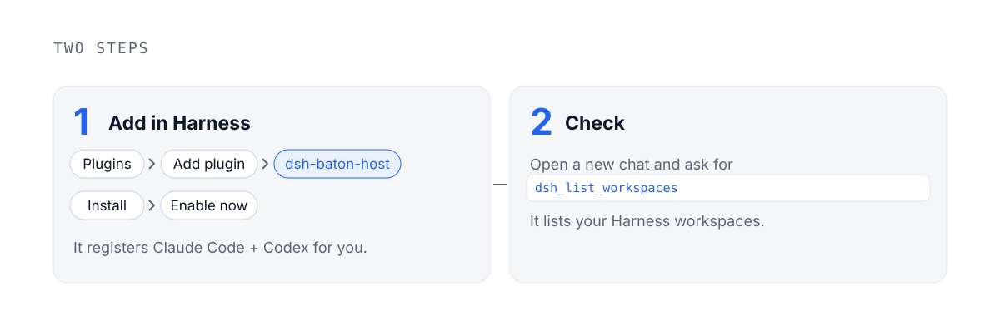
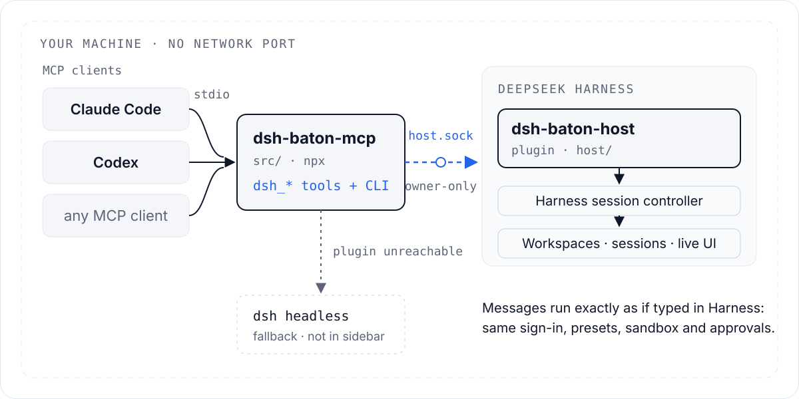
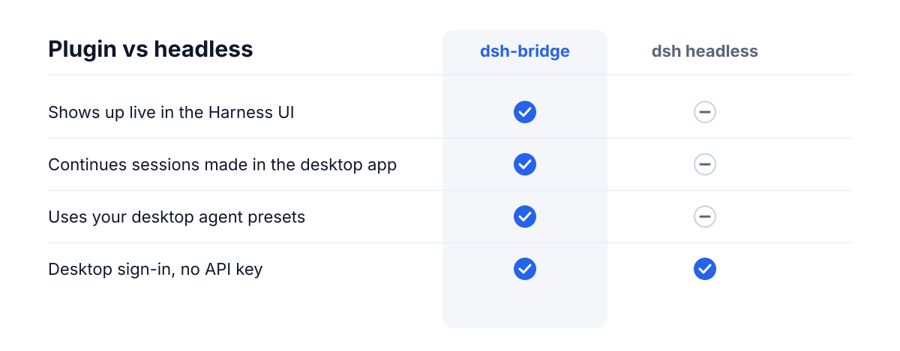
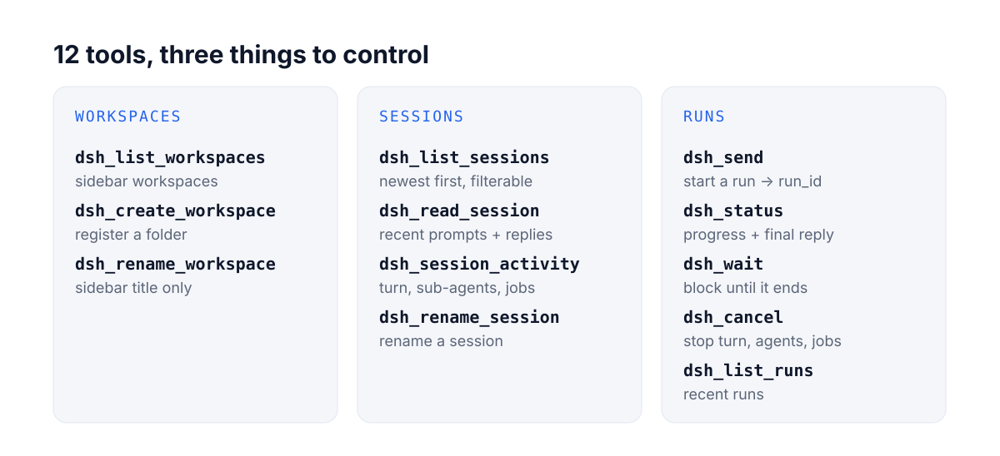
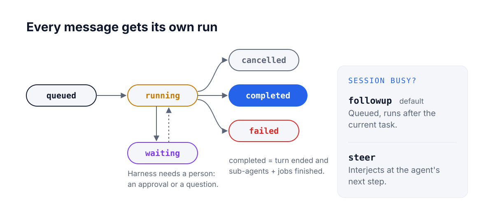
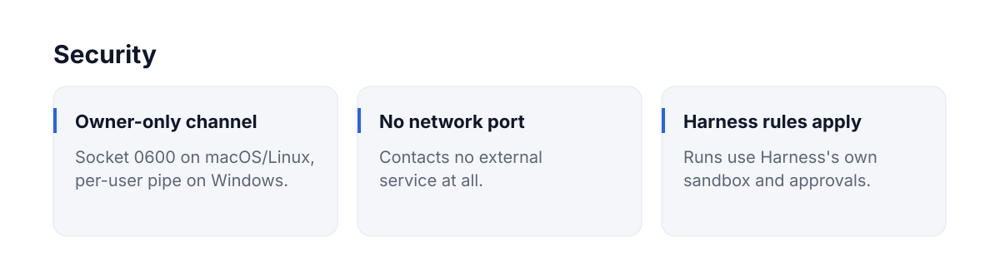
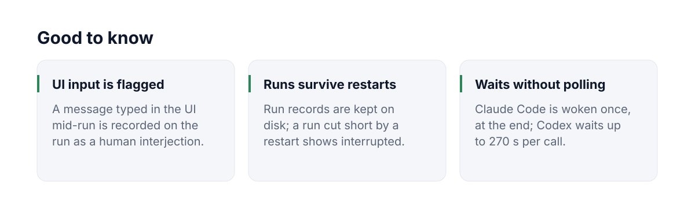

<p align="center">
  
</p>

<p align="center">
  English | <a href="README.zh-CN.md">中文</a> · Unofficial; not affiliated with DeepSeek.
</p>

<p align="center">
  
</p>

<p align="center">
  
</p>

## Quick start

<p align="center">
  
</p>

Requires DeepSeek Harness ≥ 0.2.1-rc.2 (signed in), Node.js ≥ 22.15 and git. On Windows, see [WINDOWS.md](WINDOWS.md).

> The npm packages `dsh-bridge-host` and `dsh-bridge-mcp` are not published yet, so install from a clone of this repo as below. There is nothing to `npm install`: dsh-bridge has no dependencies.

**Fastest:** paste this into Claude Code or Codex and let it do the setup:

```text
Set up dsh-bridge for me, registered globally so every conversation can use it.
1. Clone it: git clone https://github.com/JialaoLiu/dsh-bridge.git ~/dsh-bridge
2. Tell me to install the plugin in DeepSeek Harness myself: Plugins → Add plugin → paste the absolute path of ~/dsh-bridge/host → Install → Enable now. Wait until I confirm.
3. Register the MCP server at user scope, with the absolute path of node:
   Claude Code: claude mcp add dsh-bridge -s user -- "$(command -v node)" ~/dsh-bridge/src/server.mjs
   Codex:       codex mcp add dsh-bridge -- "$(command -v node)" ~/dsh-bridge/src/server.mjs
   If a command is not on PATH, write the same entry yourself: "mcpServers" in ~/.claude.json (user scope), [mcp_servers.dsh-bridge] in ~/.codex/config.toml.
4. Check: claude mcp get dsh-bridge shows "Scope: User config" and "Connected"; codex mcp list lists dsh-bridge. Then call dsh_list_workspaces and show me the result.
```

Or do it by hand:

### 1. Get the code

```bash
git clone https://github.com/JialaoLiu/dsh-bridge.git
cd dsh-bridge
```

### 2. Install the plugin in Harness

Print the absolute path of the plugin folder:

```bash
echo "$PWD/host"
```

Harness → **Plugins** → **Add plugin** → paste that path → **Install** → **Enable now** (Chinese UI: 立即应用). It starts right away: `~/.dsh-bridge/host.sock` appears. If it does not, restart Harness.

### 3. Register the MCP server, once, for every conversation

Register it at user scope, not per conversation or per project. Then every new conversation, in any folder, already has the `dsh_*` tools: no reconnecting when you switch or start conversations.

**Claude Code**: `-s user` is the important part. Without it, Claude Code registers the server for the current project folder only.

```bash
claude mcp add dsh-bridge -s user -- "$(command -v node)" "$PWD/src/server.mjs"
```

Check: `claude mcp get dsh-bridge` shows `Scope: User config (available in all your projects)` and `Status: ✔ Connected`.

**Codex**: `codex mcp add` is already user-wide. It writes to `~/.codex/config.toml`, which the Codex CLI and app share.

```bash
codex mcp add dsh-bridge -- "$(command -v node)" "$PWD/src/server.mjs"
```

Check: `codex mcp list` lists `dsh-bridge`. Codex asks you to approve MCP tool calls: approve the `dsh-bridge` tools. For unattended `codex exec` runs, add `--approve-for-me`.

**Claude desktop app (optional)**: for the chat app's connectors (Claude Code above is separate), add this to `~/Library/Application Support/Claude/claude_desktop_config.json` and restart the app. It shows as a "Local dev" connector.

```json
{ "mcpServers": { "dsh-bridge": { "command": "/absolute/path/to/node", "args": ["/absolute/path/to/dsh-bridge/src/server.mjs"] } } }
```

Notes:
- Use the absolute path of `node` (`command -v node` prints it): desktop apps start MCP servers without your shell's `PATH`.
- `claude` or `codex` not found? With only the desktop apps installed they may not be on your `PATH`. Write the entry directly instead. It is the same user-wide registration:
  - Claude Code: add it under the top-level `"mcpServers"` key of `~/.claude.json`:

    ```json
    "dsh-bridge": { "type": "stdio", "command": "/absolute/path/to/node", "args": ["/absolute/path/to/dsh-bridge/src/server.mjs"] }
    ```

  - Codex: add it to `~/.codex/config.toml`:

    ```toml
    [mcp_servers.dsh-bridge]
    command = "/absolute/path/to/node"
    args = ["/absolute/path/to/dsh-bridge/src/server.mjs"]
    ```

  The **Fastest** prompt tells Claude Code or Codex to do this for you.

### 4. Check it end to end

Start a **new** conversation in Claude Code or Codex (no reconnecting needed) and ask it to call `dsh_list_workspaces`. It lists your Harness workspaces.

**Updating:** `git pull` in the clone. Restart Harness to load plugin changes; new conversations pick up MCP server changes.

## How it works

<p align="center">
  
</p>

<p align="center">
  
</p>

## Tools

<p align="center">
  
</p>

<p align="center">
  
</p>

<details>
<summary>Full tool reference</summary>

| Tool | What it does |
|---|---|
| `dsh_list_workspaces` | Workspaces in the Harness sidebar |
| `dsh_create_workspace` | Register a folder as a workspace (creates the folder if missing); returns the existing one if already registered |
| `dsh_list_sessions` | Sessions newest first, with title, folder and running state; filter by folder or text |
| `dsh_read_session` | Recent prompts and replies of one session (with tool names) |
| `dsh_send` | Send a message: `session_id` continues that session; `cwd` or `workspace_id` starts a new one (a `cwd` that is not a workspace yet is registered first). Returns a `run_id` at once |
| `dsh_status` | Run progress: state, recent text and tool calls, final reply; `waiting_on` when the turn is over but sub-agents or jobs still run; `human_interjections` when someone typed in the Harness UI mid-run; state `interrupted` for a run cut short by a Harness restart |
| `dsh_wait` | Wait for the run to end. Returns within about 50 s (`timeout_s`) with `timed_out` if it is still going: call it again. Sends progress notifications while waiting |
| `dsh_session_activity` | What a session is doing now: running turn, sub-agents (any depth), background jobs |
| `dsh_cancel` | Stop everything a session is doing, by `run_id` or `session_id`: turn, sub-agents, jobs (queued messages stay) |
| `dsh_rename_session` | Rename a session |
| `dsh_rename_workspace` | Rename a workspace (sidebar title only; the folder is not moved) |
| `dsh_list_runs` | Recent runs |

</details>

## CLI

```bash
dsh-bridge workspaces
dsh-bridge new-workspace ~/code/new-app --title "New App"
dsh-bridge sessions --cwd ~/code/new-app
dsh-bridge send --cwd ~/code/new-app "Scaffold the project"
dsh-bridge send --session session-xxxx "Next: add tests"
dsh-bridge send --session session-xxxx --mode steer "Interjection: don't change the API"
dsh-bridge wait hrun-xxxx              # blocks, prints the final reply; exit 0 on success
dsh-bridge status hrun-xxxx
dsh-bridge activity session-xxxx       # running turn, sub-agents, background jobs
dsh-bridge cancel --session session-xxxx
dsh-bridge rename session-xxxx "New title"
dsh-bridge rename-workspace ~/code/new-app "New name"
```

## Configuration

| Variable | Default | Meaning |
|---|---|---|
| `DSH_BRIDGE_BACKEND` | `auto` | `auto`, `host` or `headless` |
| `DSH_BRIDGE_HOME` | `~/.dsh-bridge` | Socket and headless run records |
| `DSH_BRIDGE_SOCKET` | `$DSH_BRIDGE_HOME/host.sock` | Plugin socket path (must match on both sides); on Windows mapped to a per-user named pipe |
| `DSH_BIN` | the `dsh` inside the macOS app, else `PATH` | Harness CLI for headless mode |
| `DSH_HOME` | `~/.dsh` | Harness data folder (headless session reads) |
| `DSH_BRIDGE_ACCOUNT` | `1` | `0` uses the API-key route in headless mode |
| `DSH_BRIDGE_PATCHES` | empty | Extra headless `--patch` overlays, `:`-separated |

<details>
<summary>Headless fallback details</summary>

When the plugin is unreachable, the MCP server falls back to Harness's `dsh headless` command. It can only continue sessions it created itself (headless does not load agent presets such as `standard`), and new sessions do not appear in the desktop sidebar. By default [`patches/account.patch.yml`](patches/account.patch.yml) reuses the desktop app's DeepSeek account sign-in, so no API key is needed.

</details>

## Security and limits

<p align="center">
  
</p>

<p align="center">
  
</p>

Any process running as your OS user can drive Harness through the socket, the same as running `dsh` directly. dsh-bridge relies on Harness 0.2.1-series internal service APIs, so a major Harness update may need a follow-up release.

## License

MIT
