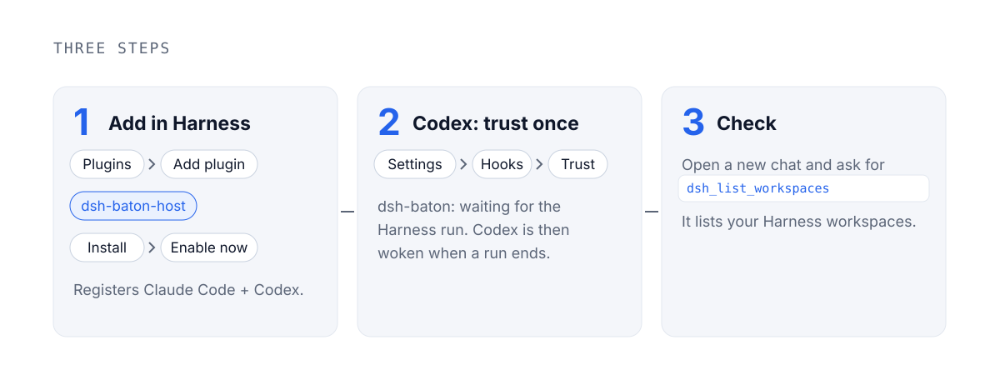
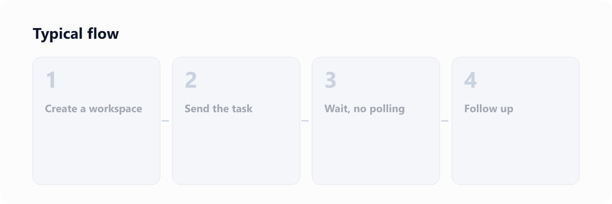
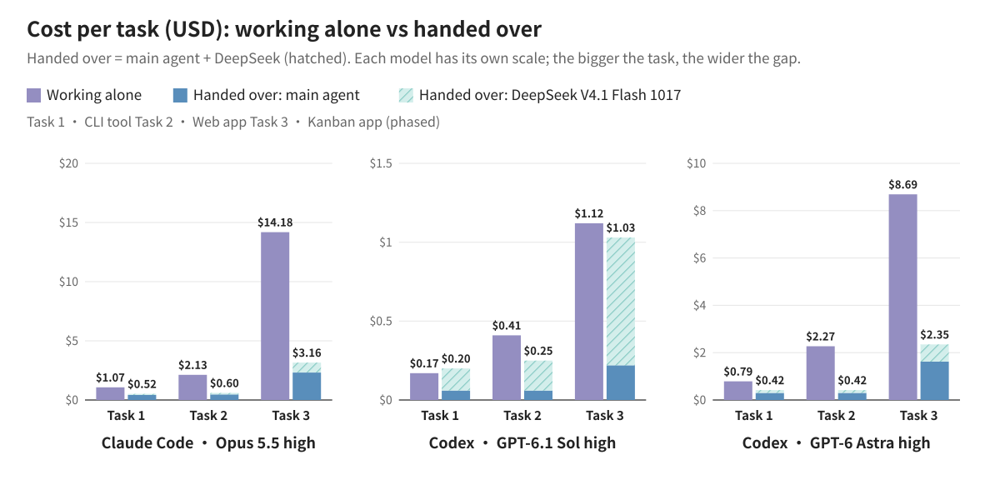
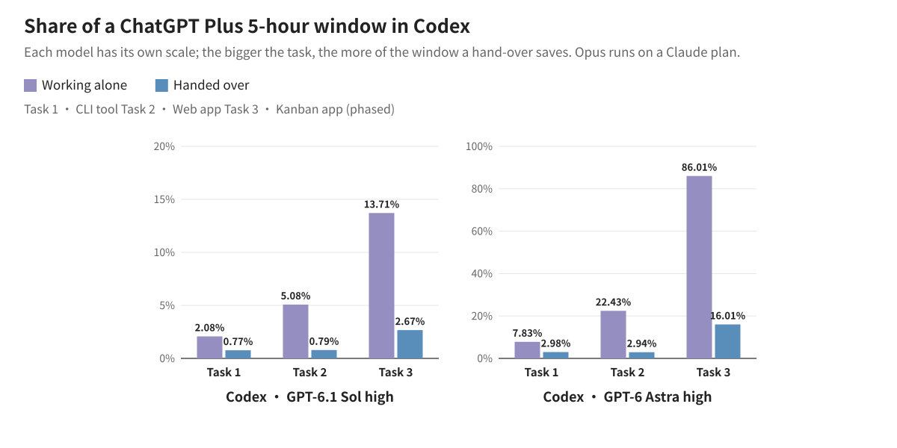
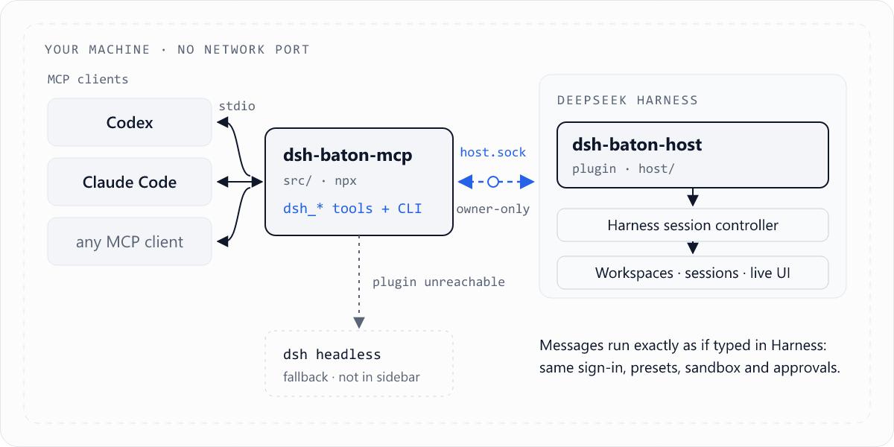
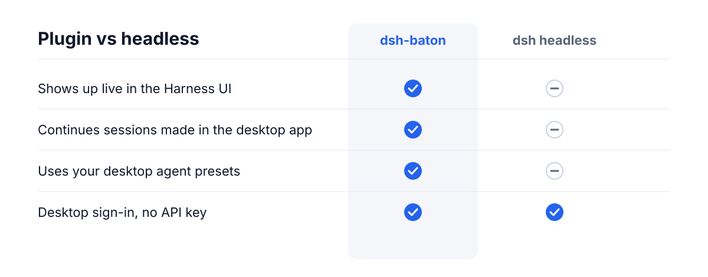
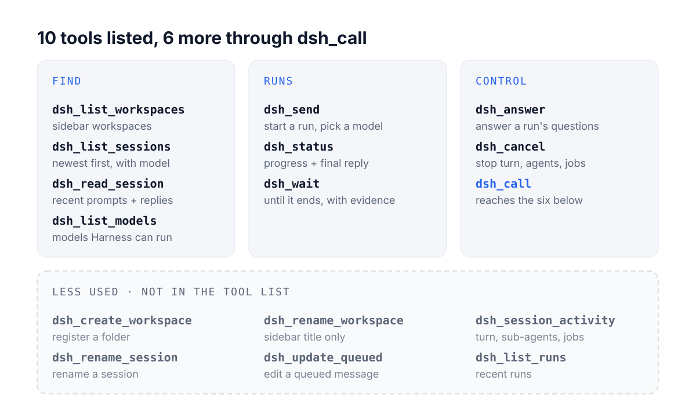
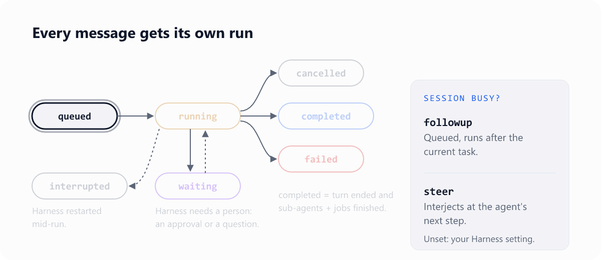
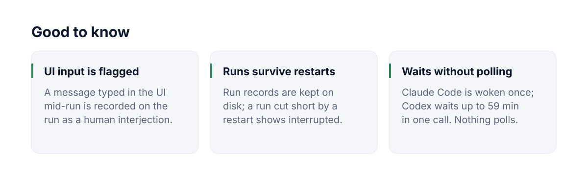

<p align="center">
  <picture><source media="(prefers-color-scheme: dark)" srcset="./assets/readme/en/hero-dark.gif"></picture>
</p>

<p align="center">
  English | <a href="README.zh-CN.md">中文</a> · macOS · Windows (<a href="WINDOWS.md">guide</a>) · no Node.js needed · zero dependencies · MIT
</p>

<p align="center"><a href="#quick-start">Quick start</a> · <a href="#see-it-run">See it run</a> · <a href="#token-usage">Token usage</a> · <a href="#how-it-works">How it works</a> · <a href="#tools">Tools</a> · <a href="#security-and-limits">Security</a></p>

<br>

Hand coding tasks from Claude Code or Codex to DeepSeek Harness on your machine: the task runs live in the Harness window, the main agent hears back once when it ends, and it gets back the files that changed, the project's own test results and a requirement-by-requirement checklist.

- **Cheaper on money and on quota:** with Claude Code, the total cost, DeepSeek included, is 51–78% lower. On a long Codex job, the share of a ChatGPT Plus 5-hour window it uses goes from 86.01% to 16.01% with GPT-6 Astra, and from 13.71% to 2.67% with GPT-6.1 Sol.
- **Nothing to watch or poll:** Claude Code is woken once when the run ends; Codex waits out a run of up to an hour in a single call.
- **A clear split of the work:** Claude Code or Codex writes the request and checks the result; DeepSeek writes the code and runs the tests in Harness. The one who checks is not the one who wrote it.

Needs DeepSeek Harness ≥ 0.2.1-rc.2 (signed in) and Claude Code or Codex. [Quick start →](#quick-start)

## What it is

dsh-baton is an MCP server plus a small Harness plugin. The main agent hands the task to an ordinary Harness session with one tool call: you watch it run in the Harness window and can step in at any time, and the main agent hears back once, without polling. Unlike a plain MCP bridge to another model, the work stays visible and the proof comes back with the result.

<p align="center"><picture><source media="(prefers-color-scheme: dark)" srcset="./assets/readme/en/divider-dark.svg"></picture></p>

## Why split the work

Beyond the savings, the split itself helps:

- **A spec before the code.** The main agent turns your request into concrete items before handing it over, so Harness gets a spec rather than a one-line "build me an X".
- **Checked on evidence.** The result carries the changed files, your project's own test output and a point-by-point check against the request; anything missing goes back for another round, instead of taking "done" on trust.
- **The main conversation keeps the decisions.** Hundreds of steps of reading files, editing and running tests stay in the Harness session; the main conversation holds your request and the conclusions.
- **Visible and steerable.** The work runs live in the Harness window. You can step in there at any time, and the main agent can steer a new requirement into the running turn.

<p align="center"><picture><source media="(prefers-color-scheme: dark)" srcset="./assets/readme/en/divider-dark.svg"></picture></p>

## Quick start

<p align="center">
  <picture><source media="(prefers-color-scheme: dark)" srcset="./assets/readme/en/install-dark.svg"></picture>
</p>

Nothing else to install: no Node.js, no terminal. The steps are the same on macOS and Windows.

**1. Add the plugin in Harness:** **Plugins** (插件) → **Add plugin** (添加插件) → type `dsh-baton-host` → **Install** (安装) → **Enable now** (立即启用).

Switched on, the plugin registers dsh-baton for Claude Code and Codex, for every folder, and Harness says so.

**2. Open a new chat:** in Claude Code or Codex, start a **new** conversation; one that was already open does not see dsh-baton yet. The steps are the same for both. Codex asks you to approve MCP tool calls: approve the `dsh-baton` tools (for unattended `codex exec` runs, add `--approve-for-me`).

**3. Check:** ask it to call `dsh_list_workspaces`. It lists your Harness workspaces.

That is all. To hand a task over, end the request with "hand it to DeepSeek Harness". Updating, removing, Windows, and registering by hand when the plugin could not, are [further down](#install-details).

**New in 0.6.4:** Codex waits in one `dsh_wait` call of up to 59 minutes, so a run that ends within the hour costs one model request to wait for, and the result arrives as an ordinary reply in the chat. Update the plugin in Harness and new Codex conversations have it, with no restart.

<p align="center"><picture><source media="(prefers-color-scheme: dark)" srcset="./assets/readme/en/divider-dark.svg"></picture></p>

## See it run

*Claude Code and Codex each hand DeepSeek Harness a task, and its subagents build this rainy-night street in 1 h 41 min. 40 s, sound on.*

https://github.com/user-attachments/assets/72e2fdff-275e-48bc-8e5a-39ffb025a0a8

<p align="center">
  <picture><source media="(prefers-color-scheme: dark)" srcset="./assets/readme/en/flow-dark.gif"></picture>
</p>

One Codex chat starts a task, queues a follow-up, steers the running turn, and waits for all three:

<p align="center">
  
</p>

Codex and Claude take turns in the same Harness session, and every message is labelled with who sent it:

<p align="center">
  
</p>

<p align="center"><a href="docs/demos.md">More demos →</a></p>

<p align="center"><picture><source media="(prefers-color-scheme: dark)" srcset="./assets/readme/en/divider-dark.svg"></picture></p>

## Token usage

**In short: hand over the big, long jobs.** With Claude Code the total cost, DeepSeek included, is 51–78% lower. With Codex on GPT-6 Astra it is 47–81% lower, and the long kanban app takes 16.01% of a ChatGPT Plus 5-hour window instead of 86.01%.

**Hand it over:** big jobs, long jobs, and whenever the 5-hour window is running low. The main agent's own spend drops 61–87% on every task and model.

**Do it yourself:** small tasks on Codex with GPT-6.1 Sol. Sol is cheap enough that DeepSeek's part of a hand-over, two thirds or more, outweighs what Sol saves.

**The three test tasks**, asked the way a user would (the requests are in Chinese, linked as written):
- **Task 1 · CLI tool:** a command-line task manager in Node, no dependencies, split into modules, with tests. [Request](docs/benchmarks/token-usage-2026-10/natural/medium.md)
- **Task 2 · Web app:** a task manager with a Node server and a page, REST API, stats, tests and a README. [Request](docs/benchmarks/token-usage-2026-10/natural/large.md)
- **Task 3 · Kanban app (phased):** a kanban board in plain Node and a plain front end, in three phases given one after another in the same conversation: ① the core (REST API, storage, drag and drop); ② labels, due dates, search syntax, archive, undo and redo, activity log, import and export; ③ version conflicts, WIP limits, bulk actions, live sync over SSE, stats. 55 acceptance tests written beforehand, the same for both arms. Requests: [phase 1](docs/benchmarks/token-usage-2026-10/xxl/seed/docs/phase1.md) · [phase 2](docs/benchmarks/token-usage-2026-10/xxl/seed/docs/phase2.md) · [phase 3](docs/benchmarks/token-usage-2026-10/xxl/seed/docs/phase3.md)

| Task 3 | Alone | Handed over |
|---|---|---|
| Opus 5.5 high | 55/55, 39 min | 55/55, 93 min |
| GPT-6.1 Sol high | 55/55, 18 min | 55/55, 101 min |
| GPT-6 Astra high | 55/55, about 31 min | 55/55, about 87 min |

Cost per task at list price, DeepSeek V4.1 Flash 1017 at its peak price. Opus 5.5 runs in Claude Code, GPT-6.1 Sol and GPT-6 Astra in Codex, all at high effort:

| Task | Model | Alone | Handed over: main agent | Handed over: DeepSeek | Handed over: total | Total | Main agent | 5-hour window, alone → handed over |
|---|---|---|---|---|---|---|---|---|
| Task 1 · CLI tool | Opus 5.5 high | $1.07 | $0.42 | $0.10 | $0.52 | −51.2% | −60.8% | — |
| | GPT-6.1 Sol high | $0.17 | $0.06 | $0.13 | $0.20 | +15.3% | −62.9% | 2.08% → 0.77% |
| | GPT-6 Astra high | $0.79 | $0.30 | $0.12 | $0.42 | −47.4% | −62.0% | 7.83% → 2.98% |
| Task 2 · Web app | Opus 5.5 high | $2.13 | $0.47 | $0.13 | $0.60 | −71.7% | −77.7% | — |
| | GPT-6.1 Sol high | $0.41 | $0.06 | $0.18 | $0.25 | −40.2% | −84.5% | 5.08% → 0.79% |
| | GPT-6 Astra high | $2.27 | $0.30 | $0.13 | $0.42 | −81.4% | −86.9% | 22.43% → 2.94% |
| Task 3 · Kanban app (phased) | Opus 5.5 high | $14.18 | $2.32 | $0.84 | $3.16 | −77.7% | −83.6% | — |
| | GPT-6.1 Sol high | $1.12 | $0.22 | $0.81 | $1.03 | −8.1% | −80.5% | 13.71% → 2.67% |
| | GPT-6 Astra high | $8.69 | $1.62 | $0.74 | $2.35 | −72.9% | −81.4% | 86.01% → 16.01% |

<p align="center">
  
</p>

<p align="center">
  
</p>

<details>
<summary>What was tested, and how</summary>

- **The only difference** in the hand-over runs is one line added at the end of the request: 交给 DeepSeek Harness 去做。 ("Hand it to DeepSeek Harness.")
- Same model and effort in both arms, and every run judged by the same acceptance check, which the model never sees.
- Tasks 1 and 2: the mean of three runs per cell. Task 3: one run per cell. Every run passed its acceptance check, with no rework.
- Prices are list prices. DeepSeek is counted at its peak price; the real DeepSeek bill came to about 58% of that.
- The 5-hour window share is worked out from each run's cost: 12.27 points per $1 for GPT-6.1 Sol, 9.90 for GPT-6 Astra.
- 0.6.2 cuts the MCP instructions to one sentence, so Codex reads a few thousand to over ten thousand fewer new input tokens per hand-over. The Codex runs were measured with 0.6.1 to 0.6.3, where a Stop hook did the waiting; from 0.6.4 one `dsh_wait` call does it, also in one model request for every 59 minutes of a run.

</details>

<p align="center"><picture><source media="(prefers-color-scheme: dark)" srcset="./assets/readme/en/divider-dark.svg"></picture></p>

## How it works

<p align="center">
  <picture><source media="(prefers-color-scheme: dark)" srcset="./assets/readme/en/architecture-dark.gif"></picture>
</p>

<p align="center">
  <picture><source media="(prefers-color-scheme: dark)" srcset="./assets/readme/en/comparison-dark.svg"></picture>
</p>

**Pick a model:** just say which one, for example "hand it to DeepSeek, V4 Pro". `dsh_send` passes it as `model` (and `reasoning_effort`), matched against the models Harness lists, so a model Harness adds later works as soon as it shows up. It applies to that session only; Harness's default model stays as it was. `dsh_list_models` shows what is available.

Nothing to configure for waiting; if you want to know what each client does while a run is going:

<details>
<summary>How each client waits</summary>

- **Claude Code** waits for a run in the background (the `wait_command` that `dsh_send` returns) and is woken once, when the run ends.
- **Codex** waits inside `dsh_wait`. The plugin sets Codex's tool timeout for dsh-baton to an hour (`tool_timeout_sec = 3600`), so one call waits up to 59 minutes: a run that ends within the hour costs one model request to wait for, however long it takes, and the result comes back as an ordinary tool result in the chat. A longer run returns `timed_out` with just the state after 59 minutes, and Codex calls again without summarising. Pressing Stop ends the wait at once. Codex gets no `wait_command`: its terminal cannot wake it, so it would poll. Conversations opened before the plugin set the timeout, or an entry you wrote yourself without it, wait 270 s per call, just under Codex's default 300 s timeout. Measured in the Codex desktop app: a 28-minute run took one `dsh_wait` call; a 62-minute run took two, the first returning `timed_out` after 59 minutes and the second getting the result 3 minutes later, with no `dsh_status` calls in between.
- **Changing the request while it waits.** In Codex, send the change with **Steer**: Codex stops waiting at once, steers it into the same Harness session (`dsh_send` with `mode` `steer`) and waits on the new run; Harness does both in the same turn. Sent with **Queue**, Codex sees it only when the run ends; you can also press Stop first and then send it. In Claude Code, just send it: it waits in the background, so it steers the change in right away. A steered run ends together with the original and they share one result; a queued run comes back on its own. Runs working in the same folder at the same time are named in each other's results, so neither removes the other's files.

</details>

### How a hand-over is checked

You don't have to take DeepSeek's word for it. Before the run, dsh-baton notes what is in the folder. When the run ends it shows exactly which files were created, changed or deleted, and runs your project's own tests itself (`npm test`, or whatever the client passes as `checks`). A second, read-only DeepSeek agent then goes through the request point by point and ends with a table: requirement, met or not, and where (file:line). Claude or GPT reads just that, sends anything missing back in one message, and opens code only where a row says "not met". Unless `cwd` names another folder, the new Harness session starts in the folder you're already working in.

<p align="center">
  
</p>

<p align="center"><picture><source media="(prefers-color-scheme: dark)" srcset="./assets/readme/en/divider-dark.svg"></picture></p>

## Tools

<p align="center">
  <picture><source media="(prefers-color-scheme: dark)" srcset="./assets/readme/en/tools-dark.svg"></picture>
</p>

<p align="center">
  <picture><source media="(prefers-color-scheme: dark)" srcset="./assets/readme/en/states-dark.gif"></picture>
</p>

When you want the exact parameters and return fields of each tool:

<details>
<summary>Full tool reference</summary>

The server's MCP instructions are a single sentence (from 0.6.2); how to hand over, wait and answer is in each tool's own description. Codex repeats the instructions in front of every tool's description, so the catalogue it shows the model is now about 9.7k characters instead of 24.3k.

| Tool | What it does |
|---|---|
| `dsh_list_workspaces` | Workspaces in the Harness sidebar |
| `dsh_create_workspace` | Through `dsh_call`. Register a folder as a workspace (creates the folder if missing); returns the existing one if already registered |
| `dsh_list_sessions` | Sessions newest first, with title, folder, running state and `model` (what its next request uses); filter by folder or text. Archived sessions are left out |
| `dsh_list_models` | The models Harness can run (provider, id, name, reasoning efforts) and its default model |
| `dsh_read_session` | Recent prompts and replies of one session (with tool names); `archived: true` for an archived session |
| `dsh_send` | Send a message: `session_id` continues that session; otherwise a new one starts in `cwd` or `workspace_id`, or, with neither, in the folder the conversation works in (a `cwd` that is not a workspace yet is registered first; a `cwd` outside the conversation's folder is allowed and noted in `folder_note`). `checks`: test commands dsh-baton runs itself when the run ends (see [How a hand-over is checked](#how-a-hand-over-is-checked)). Returns a `run_id` at once. In Harness the message is marked "Sent by Claude / ChatGPT from another chat". An archived session is refused: unarchive it in Harness, or start a new session. To a busy session, `mode` `followup` queues the message after the current turn and `steer` adds it to the running turn; left out, it does what Harness's own setting says (Settings → sending while busy: queue or steer), and `followup` when that cannot be read. `mode_source` says which applied. `model` only when the user names one ("DeepSeek-V4 Pro", "v4-pro"; `reasoning_effort` likewise): it is matched against Harness's own model list, ignoring case, spaces, hyphens and a leading DeepSeek, so a model Harness adds later (V4.1 Pro) works as soon as Harness lists it; a name that matches nothing or several fails the send, before anything is created, with the list (`provider/model` picks one). It is set on that session before the message goes in, and Harness's default model is put back as it was (Harness saves a session's pick as the default too). Left out, a continued session keeps its own model and a new one uses Harness's default. The reply says which in `model` and `model_source` |
| `dsh_status` | Run progress: state, recent text and tool calls, final reply; `waiting_on` when the turn is over but sub-agents or jobs still run; `human_interjections` when someone typed in the Harness UI mid-run; state `interrupted` for a run cut short by a Harness restart; `model` the run was sent with |
| `dsh_wait` | Wait for the run to end; a finished run carries `evidence` (files changed, check results) when the message was sent with `checks` (or until it stops to ask a person, see `dsh_answer`): up to 3540 s per call for Codex (its tool timeout for dsh-baton less 60 s; 270 s when that is not set), 50 s for other clients. Still going: returns `timed_out` with just the state; call it again. Clients that can wait in the background use `dsh_send`'s `wait_command` instead. `dsh_status` is a one-off look, not a way to wait |
| `dsh_answer` | Answer the questions a run stopped to ask (Harness's ask_user_question): per question, an option number or label, free text, or skip; one at a time or all at once. `dsh_wait` and `wait_command` return as soon as a run asks, with the questions (`needs_input`, `question`; the option Harness's model would pick is in `harness_suggested`, apart from the labels). The assistant answers by its own judgment only when you told it to decide, and then passes `reason` and tells you what it chose and why; otherwise it brings you the questions, starting with its own recommendation and reason. You can also answer in the Harness window: whoever answers first wins |
| `dsh_session_activity` | Through `dsh_call`. What a session is doing now: running turn, sub-agents (any depth), background jobs; `archived: true` for an archived session |
| `dsh_update_queued` | Through `dsh_call`. Change a message still waiting in the queue of a busy session, by its `run_id`: `edit` its text, `remove` it, or `steer` it into the running turn now. Once it has reached the conversation it can no longer be changed |
| `dsh_cancel` | Stop everything a session is doing, by `run_id` or `session_id`: turn, sub-agents, jobs. Harness also drops the messages waiting in its queue; their runs end as `cancelled` |
| `dsh_rename_session` | Through `dsh_call`. Rename a session |
| `dsh_rename_workspace` | Through `dsh_call`. Rename a workspace (sidebar title only; the folder is not moved) |
| `dsh_list_runs` | Through `dsh_call`. Recent runs, optionally of one session |
| `dsh_call` | Calls any `dsh_*` tool by name: the less used tools (create and rename workspace, rename session, session activity, update queued, list runs) are not in the tool list from 0.6.0 on, to keep every request short, and are reached this way; also for a conversation whose tool list predates an update. An unknown name lists the tools |

</details>

<p align="center"><picture><source media="(prefers-color-scheme: dark)" srcset="./assets/readme/en/divider-dark.svg"></picture></p>

## Command line and configuration

When you want to drive Harness from a terminal or a script instead of a chat:

<details>
<summary>CLI commands</summary>

```bash
dsh-baton workspaces
dsh-baton new-workspace ~/code/new-app --title "New App"
dsh-baton sessions --cwd ~/code/new-app
dsh-baton send --cwd ~/code/new-app "Scaffold the project"
dsh-baton send --session session-xxxx "Next: add tests"
dsh-baton send --session session-xxxx --mode steer "Interjection: don't change the API"
dsh-baton wait hrun-xxxx              # blocks, prints the final reply; exit 0 on success
dsh-baton status hrun-xxxx
dsh-baton activity session-xxxx       # running turn, sub-agents, background jobs
dsh-baton cancel --session session-xxxx
dsh-baton rename session-xxxx "New title"
dsh-baton rename-workspace ~/code/new-app "New name"
```

(From source, use `node src/cli.mjs …`.)

</details>

When the defaults don't fit, for example a different socket path or forcing headless mode:

<details>
<summary>Environment variables</summary>

| Variable | Default | Meaning |
|---|---|---|
| `DSH_BATON_BACKEND` | `auto` | `auto`, `host` or `headless` |
| `DSH_BATON_HOME` | `~/.dsh-baton` | Socket and headless run records |
| `DSH_BATON_SOCKET` | `$DSH_BATON_HOME/host.sock` | Plugin socket path (must match on both sides); on Windows mapped to a per-user named pipe, see [WINDOWS.md](WINDOWS.md) |
| `DSH_BATON_WAIT_S` | Codex: its `tool_timeout_sec` for dsh-baton less 60 (3540 as the plugin sets it, else 270); others `50` | How long one `dsh_wait` call waits; keep it below the client's tool timeout |
| `DSH_BIN` | the `dsh` inside the macOS app, else `PATH` | Harness CLI for headless mode |
| `DSH_HOME` | `~/.dsh` | Harness data folder (headless session reads) |
| `DSH_BATON_ACCOUNT` | `1` | `0` uses the API-key route in headless mode |
| `DSH_BATON_PATCHES` | empty | Extra headless `--patch` overlays, `:`-separated |

</details>

When the Harness plugin is not reachable:

<details>
<summary>Headless fallback details</summary>

When the plugin is unreachable, the MCP server falls back to Harness's `dsh headless` command. It can only continue sessions it created itself (headless does not load agent presets such as `standard`), and new sessions do not appear in the desktop sidebar. By default [`patches/account.patch.yml`](patches/account.patch.yml) reuses the desktop app's DeepSeek account sign-in, so no API key is needed.

</details>

<p align="center"><picture><source media="(prefers-color-scheme: dark)" srcset="./assets/readme/en/divider-dark.svg"></picture></p>

## Install details

When you update or remove the plugin, come from dsh-bridge, run from source, or the plugin could not register:

<details>
<summary>What the plugin does, updating, removing, upgrading from dsh-bridge, installing from source, Windows</summary>

**What the plugin does when switched on.** It copies the MCP server to `~/.dsh-baton/app`, a folder that stays put, and writes the MCP entry into `~/.claude.json` and `~/.codex/config.toml` directly, keeping a `*.bak-dsh-baton` backup of each. It starts the server with your own Node.js ≥ 22.15 when it finds one on `PATH`; without one, with Harness's own runtime (the Harness app in Node mode, `ELECTRON_RUN_AS_NODE=1`), so nothing else has to be installed. Either way it works with only the desktop apps installed, when `claude` / `codex` are not on your `PATH`. It runs again on each Harness start: an entry that is already right, or a working one that starts another copy of dsh-baton, is left alone. In Harness, the source switches to the npm registry ("Official npm registry", 「npm 官方源」) by itself once you type the package name, and no restart is needed. To turn the registration off, set `DSH_BATON_AUTO_REGISTER=0` for Harness.

**Codex's tool timeout.** Codex stops an MCP tool call after 300 s unless the server's table sets `tool_timeout_sec`. The plugin writes `tool_timeout_sec = 3600` into `[mcp_servers.dsh-baton]` in `~/.codex/config.toml`, and adds it to an existing table that has none; a value you set yourself is kept. The server reads it and makes each `dsh_wait` that long less 60 s. Codex reads the setting when a conversation starts and keeps it: new conversations get it without restarting Codex, while conversations already open keep Codex's 300 s limit, so dsh-baton, which tells them apart by when they started (`~/.dsh-baton/codex-timeout.json` holds when the value was written), keeps their waits at 270 s.

**Updating to 0.6.4.** Nothing to restart, approve or set. Updating the plugin in Harness installs the new server into `~/.dsh-baton/app` and writes the timeout; Codex's running server picks up the new version on its next call (it checks for a newer copy before each `tools/list` and `tools/call`). New conversations wait up to 59 minutes per call; conversations already open go on as before, with 270 s waits. The Stop hook that plugins 0.6.0 to 0.6.3 added is taken out by itself, together with its trust record; there is nothing to untick in Codex. New conversations, and every conversation after Codex restarts, have no hook at all.

**Updates need no restart.** When a newer version lands in `~/.dsh-baton/app` (a plugin update, `setup`, or a copy by hand), or the same version with changed files, conversations already open in Claude Code and Codex use it from their next `dsh_*` call: the server checks the folder before each call, starts the new version, and says once in that call's result that it was updated. A `dsh_wait` that is already running finishes on the old version first. If the new version cannot start, the old one keeps working and the result says why. A tool added in the new version shows up in Claude Code at once (the server tells the client its tool list changed); Codex keeps the tool list a conversation started with, so it does not show a new tool until the next conversation; it can still use one at once through `dsh_call`, which the update note points to, and the tools it already has run the new code right away.

**`npx -y dsh-baton-mcp setup`** does the same registration from a terminal: for a plugin that could not register, or when you come from an MCP directory. With the plugin already registered it changes nothing, then points you to the plugin if it is missing.

**Updating.** Harness has an update button only for its official plugins, so: Plugins → dsh-baton-host → **Uninstall**, then **Add plugin** → `dsh-baton-host`. For a while after a release, Harness installs the previous version instead (pnpm's `minimumReleaseAge` holds back versions published very recently, and the install dialog says so); to get the new one at once, type the version: `dsh-baton-host@0.6.4`. A pre-release must always be added by its exact version, such as `dsh-baton-host@0.6.0-next.0`: Harness resolves `@next` to a broken placeholder. Plain `dsh-baton-host` gets the latest release. Switched on again, the plugin brings the MCP server to the same version; new conversations use it. If the two are ever out of step, the first tool call that notices it says so, naming the older side and the newer side's exact version to install.

**Removing.** Harness → Plugins → dsh-baton-host → **Uninstall**, then `npx -y dsh-baton-mcp setup --remove`. The plugin cannot tell an uninstall from Harness quitting, so it leaves the MCP entries to that command, which also deletes `~/.dsh-baton/app`; run records stay in `~/.dsh-baton` until you delete it.

**Upgrading from dsh-bridge.** In Harness, uninstall `dsh-bridge-host`, then add `dsh-baton-host`; switched on, it replaces the old `dsh-bridge` MCP entries. `DSH_BRIDGE_*` variables and an existing `~/.dsh-bridge` folder keep working for now. Tools get a new prefix (`mcp__dsh-baton__…`), so update any permission allowlists. A plugin added before 0.4 by pasting `~/.dsh-baton/app/host` still works but does not update with npm: uninstall it and add `dsh-baton-host` by name.

**From source** (to follow `main` or change the code): `git clone https://github.com/JialaoLiu/dsh-baton.git`, then in Harness add the plugin from the clone's `host` folder (Add plugin → paste the path). Switched on, it registers the clone itself, so changes run before they are published. Update with `git pull`. `node dsh-baton/src/cli.mjs setup` registers the clone from a terminal.

**Windows.** Same steps; [WINDOWS.md](WINDOWS.md) covers what differs (a named pipe instead of a socket file) and fixes for a Plugins page that cannot install or uninstall.

</details>

When you register by hand, or want dsh-baton in the Claude desktop chat app (not Claude Code):

<details>
<summary>Manual registration and the Claude desktop app</summary>

The plugin and `setup` write the same entries these commands would (with the absolute path of `node`, since desktop apps start MCP servers without your shell's `PATH`):

```bash
claude mcp add dsh-baton -s user -- "$(command -v node)" "$PWD/dsh-baton/src/server.mjs"
codex mcp add dsh-baton -- "$(command -v node)" "$PWD/dsh-baton/src/server.mjs"
```

`-s user` matters: without it, Claude Code registers the server for the current project folder only.

**Claude desktop app (optional)**: for the chat app's connectors (separate from Claude Code), add this to `~/Library/Application Support/Claude/claude_desktop_config.json` and restart the app. It shows as a "Local dev" connector.

```json
{ "mcpServers": { "dsh-baton": { "command": "/absolute/path/to/node", "args": ["/absolute/path/to/dsh-baton/src/server.mjs"] } } }
```

</details>

<p align="center"><picture><source media="(prefers-color-scheme: dark)" srcset="./assets/readme/en/divider-dark.svg"></picture></p>

## Security and limits

<p align="center">
  <picture><source media="(prefers-color-scheme: dark)" srcset="./assets/readme/en/security-dark.svg"></picture>
</p>

<p align="center">
  <picture><source media="(prefers-color-scheme: dark)" srcset="./assets/readme/en/limits-dark.svg"></picture>
</p>

Any process running as your OS user can drive Harness through the socket, the same as running `dsh` directly. dsh-baton relies on Harness 0.2.1-series internal service APIs, so a major Harness update may need a follow-up release.

<p align="center"><picture><source media="(prefers-color-scheme: dark)" srcset="./assets/readme/en/divider-dark.svg"></picture></p>

## License

MIT
