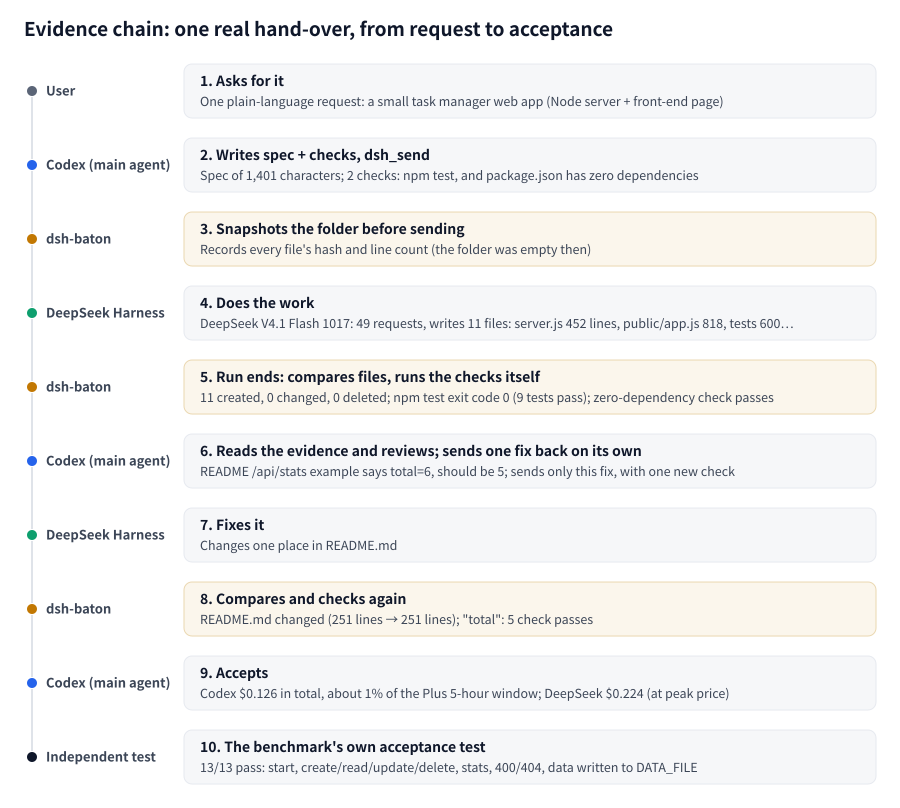
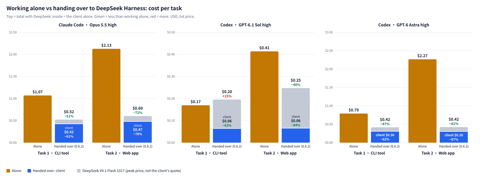
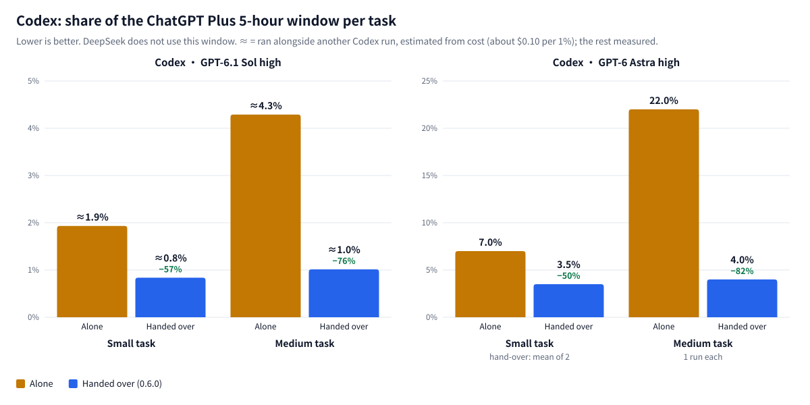
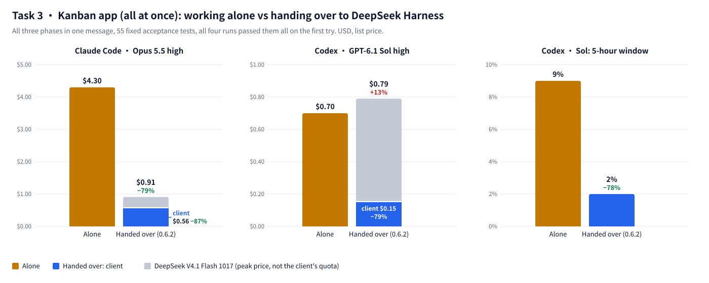
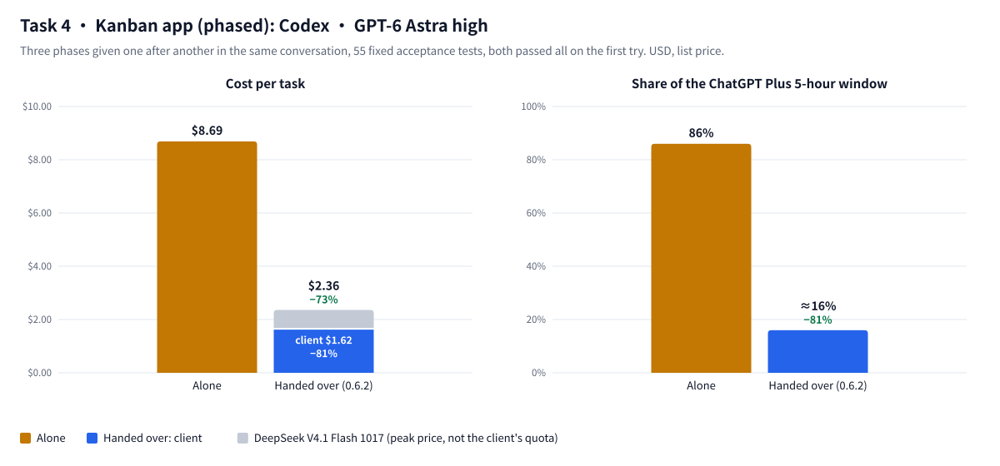

<p align="center">
  
</p>

<p align="center">
  English | <a href="README.zh-CN.md">中文</a>
</p>

<p align="center">
  macOS · Windows (<a href="WINDOWS.md">guide</a>) · no Node.js needed · zero dependencies · MIT
</p>

Claude Code and Codex each hand a task to DeepSeek Harness, and its subagents build this rainy-night street in 1 h 41 min (40 s, sound on):

https://github.com/user-attachments/assets/72e2fdff-275e-48bc-8e5a-39ffb025a0a8

<p align="center">
  
</p>

<p align="center">
  
</p>

## See it run

One Codex chat starts a task, queues a follow-up, steers the running turn, and waits for all three:

<p align="center">
  
</p>

Codex and Claude take turns in the same Harness session, and every message is labelled with who sent it:

<p align="center">
  
</p>

<p align="center"><a href="docs/demos.md">More demos →</a></p>

## Quick start

<p align="center">
  
</p>

Requires DeepSeek Harness ≥ 0.2.1-rc.2 (signed in) and Claude Code or Codex. Nothing else: no Node.js, no terminal. The steps are the same on macOS and Windows.

**1. Add the plugin in Harness:** **Plugins** (插件) → **Add plugin** (添加插件) → type `dsh-baton-host` → **Install** (安装) → **Enable now** (立即启用).

Switched on, the plugin registers dsh-baton for Claude Code and Codex, for every folder, and Harness says so.

**2. Codex only, once:** Codex **Settings → Hooks** → **Trust** **dsh-baton: waiting for the Harness run**. The hook comes with plugin 0.6.0 and later (0.6.2 and later when you have no Node.js), and shows up in that list only after you restart Harness and then Codex once, after installing or updating the plugin. Node.js is not required: without one it runs on Harness's own runtime, like the server. Codex is then woken when a run ends instead of checking every 270 s. You trust it once: updates and Harness restarts do not ask again. Skip it and Codex waits with `dsh_wait` as before; the first hand-over reminds you.

**3. Check:** in a **new** Claude Code or Codex conversation, ask it to call `dsh_list_workspaces`. It lists your Harness workspaces.

That is all. If Harness says it could not register, run `npx -y dsh-baton-mcp setup` in a terminal (this needs Node.js ≥ 22.15); it does the same registration. Updating, removing and Windows details are [further down](#install-details).

## How it works

<p align="center">
  
</p>

<p align="center">
  
</p>

**How each client waits** (nothing to configure):
- **Claude Code** waits for a run in the background (the `wait_command` that `dsh_send` returns) and is woken once, when the run ends.
- **Codex** with the dsh-baton Stop hook trusted (from 0.6.1): after `dsh_send` it ends its turn; the hook waits for the run outside the model and, when the run ends or asks something, continues the same conversation with the result. One model request per run instead of one every 270 s.
- **Codex** without the hook waits inside `dsh_wait`, up to 270 s per call, just under its 300 s tool timeout. An unfinished wait returns only the state, so Codex calls again without summarising. Codex gets no `wait_command`: its terminal cannot wake it, so it would poll.
- Codex asks you to approve MCP tool calls: approve the `dsh-baton` tools. For unattended `codex exec` runs, add `--approve-for-me`.

**Pick a model** (from 0.6.1): just say which one, for example "hand it to DeepSeek, V4 Pro". `dsh_send` passes it as `model` (and `reasoning_effort`), matched against the models Harness lists, so a model Harness adds later works as soon as it shows up. It applies to that session only; Harness's default model stays as it was. `dsh_list_models` shows what is available.

**How a hand-over is checked** (from 0.6.0)

You don't have to take DeepSeek's word for it. Before the run, dsh-baton notes what is in the folder. When the run ends it shows exactly which files were created, changed or deleted, and runs your project's own tests itself (`npm test`, or whatever the client passes as `checks`). A second, read-only DeepSeek agent then goes through the request point by point and ends with a table: requirement, met or not, and where (file:line). Claude or GPT reads just that, sends anything missing back in one message, and opens code only where a row says "not met". Unless `cwd` names another folder, the new Harness session starts in the folder you're already working in.

<p align="center">
  
</p>

## Token usage

**In short: hand over the big, long jobs.** A feature that spans many files, a large refactor, a whole small app: that is where it saves the most. Claude Code spends 51–72% less in total, DeepSeek included. Codex now saves on both test tasks (Sol 40% and Astra 81% less on the web app), and a GPT-6 Astra web-app task takes 3% of a ChatGPT Plus 5-hour window instead of 22%. On a longer job, a three-phase kanban app, Claude Code spends 79% less in total (Task 3), and Astra spends 73% less and uses about 16% of the window instead of 86% (Task 4).

**The honest part:** on the small CLI task, Codex on GPT-6.1 Sol is cheap enough that doing it alone costs a little less in total: the hand-over came out 15% more, almost all of it DeepSeek's share. The hand-over pays off when you want Claude or GPT to plan and review, a cheaper model to do the typing, and you'd rather not keep hitting the 5-hour limit.

**Who this is for:** most of us pay for Claude or ChatGPT with a plan (Plus, Pro, Max 5x…), while DeepSeek is pay-as-you-go from a balance you top up, so every hand-over is money spent outside your plan. If your plan's limits already cover how you work, you don't need this: keep it simple and keep the money. If you're like me and keep running long, messy jobs with round after round of changes, and keep hitting the limit, a little DeepSeek spend gets you a lot more out of the plan you already pay for.

**The two test tasks**, asked the way a user would (the requests are in Chinese, linked as written):
- **Task 1 · CLI tool:** a command-line task manager in Node, no dependencies, split into modules, with tests. [Request](docs/benchmarks/token-usage-2026-10/natural/medium.md)
- **Task 2 · Web app:** a task manager with a Node server and a page, REST API, stats, tests and a README. [Request](docs/benchmarks/token-usage-2026-10/natural/large.md)

<p align="center">
  
</p>

Cost per task at list price, DeepSeek V4.1 Flash 1017 at its peak price:

| Client · model | Task | Alone | Handed over, client only | Handed over, with DeepSeek |
|---|---|---|---|---|
| Claude Code · Opus 5.5 high | Task 1 · CLI tool | $1.07 | $0.42 (−61%) | $0.52 (−51%) |
| Claude Code · Opus 5.5 high | Task 2 · Web app | $2.13 | $0.47 (−78%) | $0.60 (−72%) |
| Codex · GPT-6.1 Sol high | Task 1 · CLI tool | $0.17 | $0.06 (−63%) | $0.20 (+15%) |
| Codex · GPT-6.1 Sol high | Task 2 · Web app | $0.41 | $0.06 (−84%) | $0.25 (−40%) |
| Codex · GPT-6 Astra high | Task 1 · CLI tool | $0.79 | $0.30 (−62%) | $0.42 (−47%) |
| Codex · GPT-6 Astra high | Task 2 · Web app | $2.27 | $0.30 (−87%) | $0.42 (−81%) |

<p align="center">
  
</p>

Share of the ChatGPT Plus 5-hour window per task: Task 1 Sol 1.9% → ≈0.6%, Task 2 Sol 4.3% → ≈0.6%, Task 1 Astra 7% → 3%, Task 2 Astra 22% → 3% (≈ estimated from cost).

**Why it got cheaper:** from 0.6.1 Codex is woken by its Stop hook instead of polling with `dsh_wait`, and 0.6.2 cuts the MCP instructions to one sentence, so Codex reads a few thousand to over ten thousand fewer new input tokens per hand-over.

**Task 3 · Kanban app (all at once):** a kanban board in plain Node and a plain front end, in three phases: ① the core (REST API, storage, drag and drop); ② labels, due dates, search syntax, archive, undo and redo, activity log, import and export; ③ version conflicts, WIP limits, bulk actions, live sync over SSE, stats. Here all three phases come in one request. Each phase has acceptance tests written beforehand, the same for both arms, 55 in all. Requests: [phase 1](docs/benchmarks/token-usage-2026-10/xxl/seed/docs/phase1.md) · [phase 2](docs/benchmarks/token-usage-2026-10/xxl/seed/docs/phase2.md) · [phase 3](docs/benchmarks/token-usage-2026-10/xxl/seed/docs/phase3.md)

<p align="center">
  
</p>

| Task 3 | Alone | Handed over (0.6.2) |
|---|---|---|
| Claude Code · Opus 5.5 high | $4.30, about 20 min | $0.91 (−79%; client $0.56, DeepSeek $0.35), about 38 min |
| Codex · GPT-6.1 Sol high | $0.70, 9% of the window, about 11 min | $0.79 (+13%; client $0.15, DeepSeek $0.65), 2% of the window (−78%), about 38 min |

All four runs passed 55/55 with no rework. Sol is cheap on its own, so the extra cost is the code DeepSeek writes; Codex's own spend and its 5-hour window still drop by about four fifths.

**Task 4 · Kanban app (phased):** the same app, but the three phases are given one after another in the same conversation. Codex · GPT-6 Astra high:

<p align="center">
  
</p>

| Codex · GPT-6 Astra high | Alone | Handed over (0.6.2) |
|---|---|---|
| Client | $8.69 | $1.62 (−81%) |
| DeepSeek | – | $0.74 |
| Total | $8.69 | $2.36 (−73%) |
| 5-hour window | 86% | about 16% (−81%) |
| Acceptance tests | 55/55, first try | 55/55, first try |
| Time | about 31 min | about 87 min |
| Lines of code | 1,876 | 9,953 |

<details>
<summary>What was tested, and how</summary>

- **The only difference** in the hand-over runs is one line added at the end of the request: 交给 DeepSeek Harness 去做。 ("Hand it to DeepSeek Harness.")
- Same model and effort in both arms, and every run judged by the same acceptance check, which the model never sees.
- Working alone: the earlier mean of three runs per cell (Astra: one run each). Handed over with 0.6.2: one run per cell; all six passed the first time, with no rework and no `dsh_wait` call.
- Prices are list prices. DeepSeek is counted at its peak price, the most conservative case; the real DeepSeek bill came to about 58% of that.

</details>

## Tools

<p align="center">
  
</p>

<p align="center">
  
</p>

<details>
<summary>Full tool reference</summary>

The server's MCP instructions are a single sentence (from 0.6.2); how to hand over, wait and answer is in each tool's own description. Codex repeats the instructions in front of every tool's description, so the catalogue it shows the model is now about 9.7k characters instead of 24.3k.

| Tool | What it does |
|---|---|
| `dsh_list_workspaces` | Workspaces in the Harness sidebar |
| `dsh_create_workspace` | Through `dsh_call`. Register a folder as a workspace (creates the folder if missing); returns the existing one if already registered |
| `dsh_list_sessions` | Sessions newest first, with title, folder, running state and `model` (what its next request uses); filter by folder or text. Archived sessions are left out |
| `dsh_list_models` | The models Harness can run (provider, id, name, reasoning efforts) and its default model |
| `dsh_read_session` | Recent prompts and replies of one session (with tool names); `archived: true` for an archived session |
| `dsh_send` | Send a message: `session_id` continues that session; otherwise a new one starts in `cwd` or `workspace_id`, or, with neither, in the folder the conversation works in (a `cwd` that is not a workspace yet is registered first; a `cwd` outside the conversation's folder is allowed and noted in `folder_note`). `checks`: test commands dsh-baton runs itself when the run ends (see How a hand-over is checked). Returns a `run_id` at once. In Harness the message is marked "Sent by Claude / ChatGPT from another chat". An archived session is refused: unarchive it in Harness, or start a new session. To a busy session, `mode` `followup` queues the message after the current turn and `steer` adds it to the running turn; left out, it does what Harness's own setting says (Settings → sending while busy: queue or steer), and `followup` when that cannot be read. `mode_source` says which applied. `model` only when the user names one ("DeepSeek-V4 Pro", "v4-pro"; `reasoning_effort` likewise): it is matched against Harness's own model list, ignoring case, spaces, hyphens and a leading DeepSeek, so a model Harness adds later (V4.1 Pro) works as soon as Harness lists it; a name that matches nothing or several fails the send, before anything is created, with the list (`provider/model` picks one). It is set on that session before the message goes in, and Harness's default model is put back as it was (Harness saves a session's pick as the default too). Left out, a continued session keeps its own model and a new one uses Harness's default. The reply says which in `model` and `model_source` |
| `dsh_status` | Run progress: state, recent text and tool calls, final reply; `waiting_on` when the turn is over but sub-agents or jobs still run; `human_interjections` when someone typed in the Harness UI mid-run; state `interrupted` for a run cut short by a Harness restart; `model` the run was sent with |
| `dsh_wait` | Codex with the Stop hook trusted does not need it. Wait for the run to end; a finished run carries `evidence` (files changed, check results) when the message was sent with `checks` (or until it stops to ask a person, see `dsh_answer`): up to 270 s per call for Codex, 50 s for other clients. Still going: returns `timed_out` with just the state; call it again. Clients that can wait in the background use `dsh_send`'s `wait_command` instead. `dsh_status` is a one-off look, not a way to wait |
| `dsh_answer` | Answer the questions a run stopped to ask (Harness's ask_user_question): per question, an option number or label, free text, or skip; one at a time or all at once. `dsh_wait` and `wait_command` return as soon as a run asks, with the questions (`needs_input`, `question`; the option Harness's model would pick is in `harness_suggested`, apart from the labels). The assistant answers by its own judgment only when you told it to decide, and then passes `reason` and tells you what it chose and why; otherwise it brings you the questions, starting with its own recommendation and reason. You can also answer in the Harness window: whoever answers first wins |
| `dsh_session_activity` | Through `dsh_call`. What a session is doing now: running turn, sub-agents (any depth), background jobs; `archived: true` for an archived session |
| `dsh_update_queued` | Through `dsh_call`. Change a message still waiting in the queue of a busy session, by its `run_id`: `edit` its text, `remove` it, or `steer` it into the running turn now. Once it has reached the conversation it can no longer be changed |
| `dsh_cancel` | Stop everything a session is doing, by `run_id` or `session_id`: turn, sub-agents, jobs. Harness also drops the messages waiting in its queue; their runs end as `cancelled` |
| `dsh_rename_session` | Through `dsh_call`. Rename a session |
| `dsh_rename_workspace` | Through `dsh_call`. Rename a workspace (sidebar title only; the folder is not moved) |
| `dsh_list_runs` | Through `dsh_call`. Recent runs, optionally of one session |
| `dsh_call` | Calls any `dsh_*` tool by name: the less used tools (create and rename workspace, rename session, session activity, update queued, list runs) are not in the tool list from 0.6.0 on, to keep every request short, and are reached this way; also for a conversation whose tool list predates an update. An unknown name lists the tools |

</details>

## CLI

```bash
dsh-baton workspaces
dsh-baton new-workspace ~/code/new-app --title "New App"
dsh-baton sessions --cwd ~/code/new-app
dsh-baton send --cwd ~/code/new-app "Scaffold the project"
dsh-baton send --session session-xxxx "Next: add tests"
dsh-baton send --session session-xxxx --mode steer "Interjection: don't change the API"
dsh-baton wait hrun-xxxx              # blocks, prints the final reply; exit 0 on success
dsh-baton status hrun-xxxx
dsh-baton activity session-xxxx       # running turn, sub-agents, background jobs
dsh-baton cancel --session session-xxxx
dsh-baton rename session-xxxx "New title"
dsh-baton rename-workspace ~/code/new-app "New name"
```

## Configuration

| Variable | Default | Meaning |
|---|---|---|
| `DSH_BATON_BACKEND` | `auto` | `auto`, `host` or `headless` |
| `DSH_BATON_HOME` | `~/.dsh-baton` | Socket and headless run records |
| `DSH_BATON_SOCKET` | `$DSH_BATON_HOME/host.sock` | Plugin socket path (must match on both sides); on Windows mapped to a per-user named pipe |
| `DSH_BATON_WAIT_S` | `270` for Codex, else `50` | How long one `dsh_wait` call waits; set it only if you raised the client's tool timeout, and keep it below that |
| `DSH_BATON_CODEX_HOOK` | `1` | `0` (set for Harness) stops the plugin adding the Codex Stop hook |
| `DSH_BIN` | the `dsh` inside the macOS app, else `PATH` | Harness CLI for headless mode |
| `DSH_HOME` | `~/.dsh` | Harness data folder (headless session reads) |
| `DSH_BATON_ACCOUNT` | `1` | `0` uses the API-key route in headless mode |
| `DSH_BATON_PATCHES` | empty | Extra headless `--patch` overlays, `:`-separated |

<details>
<summary>Headless fallback details</summary>

When the plugin is unreachable, the MCP server falls back to Harness's `dsh headless` command. It can only continue sessions it created itself (headless does not load agent presets such as `standard`), and new sessions do not appear in the desktop sidebar. By default [`patches/account.patch.yml`](patches/account.patch.yml) reuses the desktop app's DeepSeek account sign-in, so no API key is needed.

</details>

## Install details

<details>
<summary>What the plugin does, updating, removing, upgrading from dsh-bridge, installing from source, Windows</summary>

**What the plugin does when switched on.** It copies the MCP server to `~/.dsh-baton/app`, a folder that stays put, and writes the MCP entry into `~/.claude.json` and `~/.codex/config.toml` directly, keeping a `*.bak-dsh-baton` backup of each. It starts the server with your own Node.js ≥ 22.15 when it finds one on `PATH`; without one, with Harness's own runtime (the Harness app in Node mode, `ELECTRON_RUN_AS_NODE=1`), so nothing else has to be installed. Either way it works with only the desktop apps installed, when `claude` / `codex` are not on your `PATH`. It runs again on each Harness start: an entry that is already right, or a working one that starts another copy of dsh-baton, is left alone. In Harness, the source switches to the npm registry ("Official npm registry", 「npm 官方源」) by itself once you type the package name, and no restart is needed. To turn the registration off, set `DSH_BATON_AUTO_REGISTER=0` for Harness.

**The Codex Stop hook.** The plugin adds one `[[hooks.Stop]]` block, marked `# dsh-baton`, to `~/.codex/config.toml`; Codex shows it as **dsh-baton: waiting for the Harness run** and runs it only once you trust it (dsh-baton never trusts it for you). The block only names a small script, `~/.dsh-baton/bin/codex-stop-hook` (`codex-stop-hook.cmd` on Windows), and everything that can move, Node.js and the server, lives in that script. So the block itself never changes: updates, same-version refreshes and Harness restarts leave it as it is, and your trust stays. If the block is ever rewritten, dsh-baton drops the old trust record, and Codex asks you to trust it again. Windows uses a `.cmd` because Codex runs hooks through `PowerShell -Command`, which cannot start a quoted program path. Without a Node.js of your own, the script runs Harness's own app in Node mode (`ELECTRON_RUN_AS_NODE=1`), as the server does; the plugin rewrites it on each start, so it follows Harness updates. Not added without Codex, with `DSH_BATON_CODEX_HOOK=0`, or when Codex's dsh-baton entry names no server folder (a bare `npx` command); the first hand-over in a Codex conversation then says why. `dsh-baton setup --codex-hook` adds it by hand, `setup --remove` takes it out, `DSH_BATON_CODEX_HOOK=0` for Harness stops the plugin adding it.

**Updates need no restart.** When a newer version lands in `~/.dsh-baton/app` (a plugin update, `setup`, or a copy by hand), or the same version with changed files, conversations already open in Claude Code and Codex use it from their next `dsh_*` call: the server checks the folder before each call, starts the new version, and says once in that call's result that it was updated. A `dsh_wait` that is already running finishes on the old version first. If the new version cannot start, the old one keeps working and the result says why. A tool added in the new version shows up in Claude Code at once (the server tells the client its tool list changed); Codex keeps the tool list a conversation started with, so it does not show a new tool until the next conversation; from 0.5.9 on it can still use one at once through `dsh_call`, which the update note points to, and the tools it already has run the new code right away. This works from the version after 0.5.8 on; a server started from 0.5.8 or earlier needs one last restart (or `/mcp` reconnect) to pick it up.

**`npx -y dsh-baton-mcp setup`** does the same registration from a terminal: for a plugin that could not register, or when you come from an MCP directory. With the plugin already registered it changes nothing, then points you to the plugin if it is missing.

**Updating.** Harness has an update button only for its official plugins, so: Plugins → dsh-baton-host → **Uninstall**, then **Add plugin** → `dsh-baton-host`. For a while after a release, Harness installs the previous version instead (pnpm's `minimumReleaseAge` holds back versions published very recently, and the install dialog says so); to get the new one at once, type the version: `dsh-baton-host@0.6.2`. A pre-release must always be added by its exact version, such as `dsh-baton-host@0.6.0-next.0`: Harness resolves `@next` to a broken placeholder. Plain `dsh-baton-host` gets the latest release. Switched on again, the plugin brings the MCP server to the same version; new conversations use it. If the two are ever out of step, the first tool call that notices it says so, naming the older side and the newer side's exact version to install.

**Removing.** Harness → Plugins → dsh-baton-host → **Uninstall**, then `npx -y dsh-baton-mcp setup --remove`. The plugin cannot tell an uninstall from Harness quitting, so it leaves the MCP entries to that command, which also deletes `~/.dsh-baton/app`; run records stay in `~/.dsh-baton` until you delete it.

**Upgrading from dsh-bridge.** In Harness, uninstall `dsh-bridge-host`, then add `dsh-baton-host`; switched on, it replaces the old `dsh-bridge` MCP entries. `DSH_BRIDGE_*` variables and an existing `~/.dsh-bridge` folder keep working for now. Tools get a new prefix (`mcp__dsh-baton__…`), so update any permission allowlists. A plugin added before 0.4 by pasting `~/.dsh-baton/app/host` still works but does not update with npm: uninstall it and add `dsh-baton-host` by name.

**From source** (to follow `main` or change the code): `git clone https://github.com/JialaoLiu/dsh-baton.git`, then in Harness add the plugin from the clone's `host` folder (Add plugin → paste the path). Switched on, it registers the clone itself, so changes run before they are published. Update with `git pull`. `node dsh-baton/src/cli.mjs setup` registers the clone from a terminal.

**Windows.** Same steps; [WINDOWS.md](WINDOWS.md) covers what differs (a named pipe instead of a socket file) and fixes for a Plugins page that cannot install or uninstall.

<details>
<summary>Manual registration and the Claude desktop app</summary>

The plugin and `setup` write the same entries these commands would (with the absolute path of `node`, since desktop apps start MCP servers without your shell's `PATH`):

```bash
claude mcp add dsh-baton -s user -- "$(command -v node)" "$PWD/dsh-baton/src/server.mjs"
codex mcp add dsh-baton -- "$(command -v node)" "$PWD/dsh-baton/src/server.mjs"
```

`-s user` matters: without it, Claude Code registers the server for the current project folder only.

**Claude desktop app (optional)**: for the chat app's connectors (separate from Claude Code), add this to `~/Library/Application Support/Claude/claude_desktop_config.json` and restart the app. It shows as a "Local dev" connector.

```json
{ "mcpServers": { "dsh-baton": { "command": "/absolute/path/to/node", "args": ["/absolute/path/to/dsh-baton/src/server.mjs"] } } }
```

</details>

</details>

## Security and limits

<p align="center">
  
</p>

<p align="center">
  
</p>

Any process running as your OS user can drive Harness through the socket, the same as running `dsh` directly. dsh-baton relies on Harness 0.2.1-series internal service APIs, so a major Harness update may need a follow-up release.

<p align="center"><a href="docs/demos.md">More demos →</a></p>

## License

MIT
