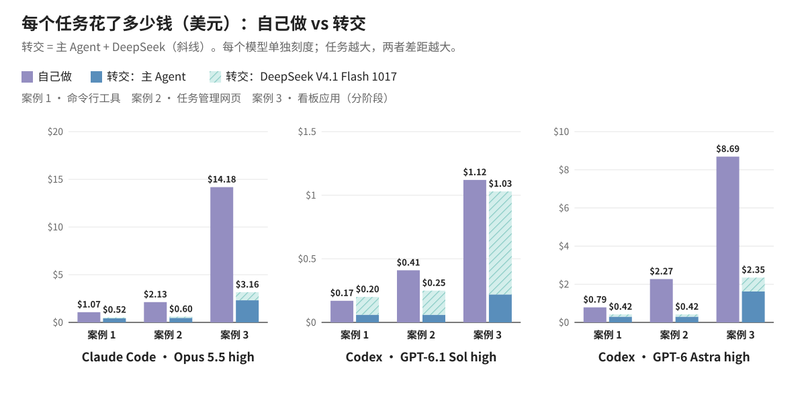
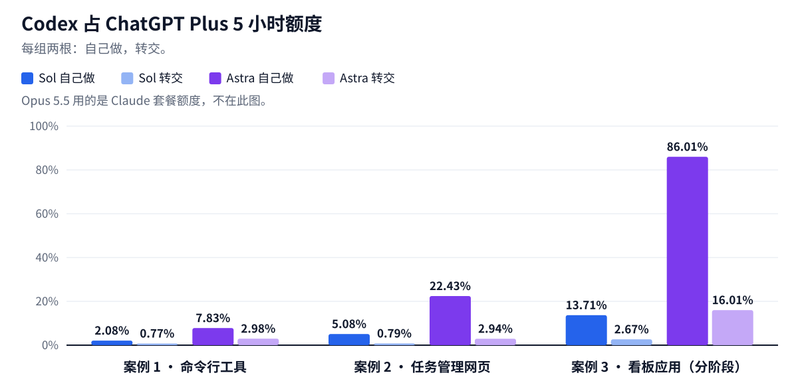
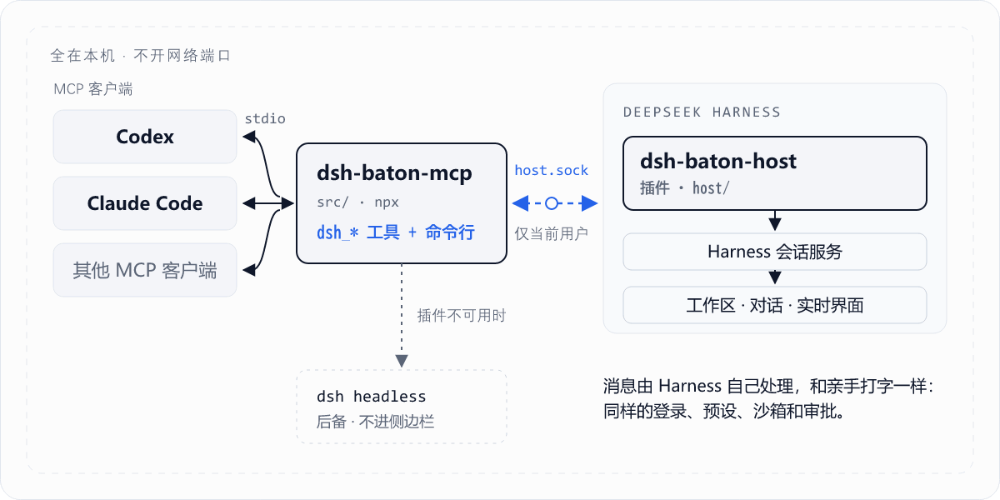
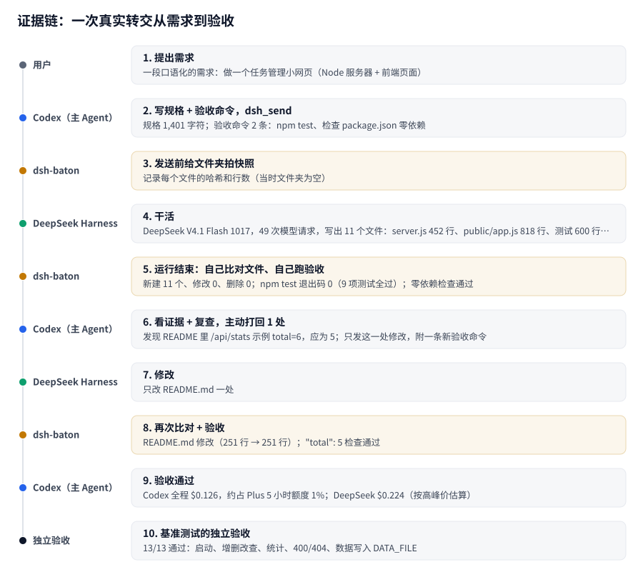
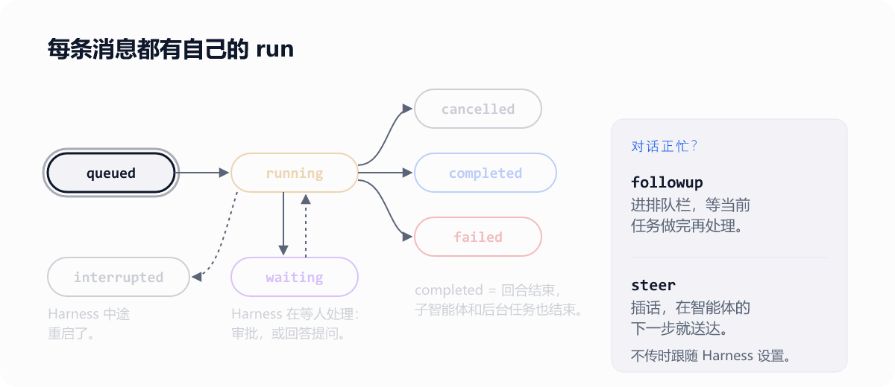

<p align="center">
  <picture><source media="(prefers-color-scheme: dark)" srcset="./assets/readme/zh/hero-dark.gif"></picture>
</p>

<p align="center">
  <a href="README.md">English</a> | 中文 · macOS · Windows（<a href="WINDOWS.md">说明</a>）· 不用装 Node.js · 零依赖 · MIT
</p>

<p align="center"><a href="#快速上手">快速上手</a> · <a href="#看它跑">看它跑</a> · <a href="#token-用量实测">Token 用量</a> · <a href="#工作原理">工作原理</a> · <a href="#工具">工具</a> · <a href="#安全与限制">安全</a></p>

<br>

把 Claude Code 或 Codex 的编码任务交给本机的 DeepSeek Harness：任务在 Harness 界面里实时跑，跑完主 Agent 收到一次结果，带回改了哪些文件、项目自己的测试结果，以及逐条需求对照表。

- **省钱也省额度**：Claude Code 连 DeepSeek 一起算，总花费少 51–78%。Codex 长任务占 ChatGPT Plus 5 小时额度的比例，用 GPT-6 Astra 从 86.01% 降到 16.01%，用 GPT-6.1 Sol 从 13.71% 降到 2.67%。
- **不用盯、不用轮询**：Claude Code 跑完只被唤醒一次，Codex 一次调用就能等完一小时以内的任务。
- **分工明确**：Claude Code 或 Codex 定需求、做验收，DeepSeek 在 Harness 里写代码、跑测试。验收的一方不是写代码的一方。

需要 DeepSeek Harness ≥ 0.2.1-rc.2（已登录）和 Claude Code 或 Codex。[快速上手 →](#快速上手)

## 这是什么

dsh-baton 是一个 MCP 服务器加一个 Harness 小插件。主 Agent 用一次工具调用把任务交给一个普通的 Harness 对话：你在界面里看着它跑，随时能插话；跑完主 Agent 只收到一次结果，不用轮询。和普通的 MCP 桥接另一个模型相比，过程看得见，证据随结果一起带回来。

<p align="center"><picture><source media="(prefers-color-scheme: dark)" srcset="./assets/readme/zh/divider-dark.svg"></picture></p>

## 为什么要分工

省钱之外，分工本身也有好处：

- **先写规格，再动手**。主 Agent 先把你的需求拆成明确的条目再交出去，Harness 拿到的是一份规格，而不是一句“帮我做个 X”。
- **验收看证据**。结果带回改动文件、项目自己的测试输出和逐条需求对照；没做到的条目再发回去改，不靠一句“做完了”。
- **主对话只留决策**。几百步的读文件、改代码、跑测试都留在 Harness 对话里，主对话里只有你的需求和结论。
- **看得见、能插话**。执行过程在 Harness 界面里实时显示，你随时可以在那里插话；主 Agent 也能把新要求插进正在跑的回合。

<p align="center"><picture><source media="(prefers-color-scheme: dark)" srcset="./assets/readme/zh/divider-dark.svg"></picture></p>

## 快速上手

<p align="center">
  <picture><source media="(prefers-color-scheme: dark)" srcset="./assets/readme/zh/install-dark.svg"></picture>
</p>

别的都不用装：不用 Node.js，也不用开终端。macOS 和 Windows 步骤完全相同。

**1. 在 Harness 里添加插件：** **插件** → **添加插件** → 输入 `dsh-baton-host` → **安装** → **立即启用**。

插件启用后会为 Claude Code 和 Codex 注册 dsh-baton（对所有文件夹生效），Harness 里会弹出提示。

**2. 新开对话**：在 Claude Code 或 Codex 里**新开**一个对话，之前开着的对话还看不到 dsh-baton。两边步骤一样。Codex 调用 MCP 工具时会请你批准，批准 `dsh-baton` 的工具即可（无人值守的 `codex exec` 加上 `--approve-for-me`）。

**3. 检查**：让它调用 `dsh_list_workspaces`，会列出你的 Harness 工作区。

就这些。要转交任务，在需求最后加一句“交给 DeepSeek Harness 去做”。更新、卸载、Windows，以及插件没能注册时怎么手动注册，在[后面](#安装细节)。

**0.6.4 新变化**：Codex 一次 `dsh_wait` 最多等 59 分钟，一小时以内跑完的任务等待只花一次模型请求，结果作为普通回复回到对话里。在 Harness 里更新插件，新开的 Codex 对话就用上了，不用重启。

<p align="center"><picture><source media="(prefers-color-scheme: dark)" srcset="./assets/readme/zh/divider-dark.svg"></picture></p>

## 看它跑

*Claude Code 和 Codex 各派一个任务给 DeepSeek Harness，它的子代理用 1 小时 41 分搭出了这条雨夜街道。40 秒，建议开声音。*

https://github.com/user-attachments/assets/ed931637-acb3-4c16-8c52-72298ea90485

<p align="center">
  <picture><source media="(prefers-color-scheme: dark)" srcset="./assets/readme/zh/flow-dark.gif"></picture>
</p>

一个 Codex 对话里完成新建、排队、插队和等待：

<p align="center">
  
</p>

Codex 和 Claude 轮流往同一个 Harness 对话发消息，每条都标明是谁发的：

<p align="center">
  
</p>

<p align="center"><a href="docs/demos.zh-CN.md">更多演示 →</a></p>

<p align="center"><picture><source media="(prefers-color-scheme: dark)" srcset="./assets/readme/zh/divider-dark.svg"></picture></p>

## Token 用量实测

**一句话：大活、长活交给它**。Claude Code 连 DeepSeek 一起算，总花费少 51–78%；Codex 用 GPT-6 Astra 少 47–81%，分阶段的看板应用占 ChatGPT Plus 5 小时额度从 86.01% 降到 16.01%。

**适合转交**：大任务、长任务，以及 5 小时额度快用完的时候。每个案例、每个模型，主 Agent 自己的花费都少了 61–87%。

**适合自己做**：Codex 用 GPT-6.1 Sol 的小任务。Sol 本身够便宜，转交时 DeepSeek 那部分要占到三分之二以上，抵掉了 Sol 省下的钱。

**三个测试案例**，都按普通用户的口吻提需求（原文可以直接点开看）：
- **案例 1 · 命令行工具**：用 Node 写一个命令行任务管理工具，零依赖，分模块，带测试。[需求原文](docs/benchmarks/token-usage-2026-10/natural/medium.md)
- **案例 2 · 任务管理网页**：Node 服务器加前端页面，REST 接口、统计、测试和 README。[需求原文](docs/benchmarks/token-usage-2026-10/natural/large.md)
- **案例 3 · 看板应用（分阶段）**：只用 Node 内置模块和原生前端的看板应用，三个阶段在同一个对话里依次给：① 主体（REST 接口、持久化、前端拖拽）；② 标签、截止日期、搜索语法、归档、撤销重做、活动日志、导入导出；③ 版本冲突检测、WIP 上限、批量操作、SSE 实时同步、统计。事先写好 55 项验收测试，两组用同一套。需求原文：[阶段 1](docs/benchmarks/token-usage-2026-10/xxl/seed/docs/phase1.md) · [阶段 2](docs/benchmarks/token-usage-2026-10/xxl/seed/docs/phase2.md) · [阶段 3](docs/benchmarks/token-usage-2026-10/xxl/seed/docs/phase3.md)

| 案例 3 | 自己做 | 转交 |
|---|---|---|
| Opus 5.5 high | 55/55，39 分钟 | 55/55，93 分钟 |
| GPT-6.1 Sol high | 55/55，18 分钟 | 55/55，101 分钟 |
| GPT-6 Astra high | 55/55，约 31 分钟 | 55/55，约 87 分钟 |

每个任务的花费，按标价计，DeepSeek V4.1 Flash 1017 按高峰价。Opus 5.5 跑在 Claude Code 里，GPT-6.1 Sol 和 GPT-6 Astra 跑在 Codex 里，推理强度都是 high：

| 案例 | 模型 | 自己做 | 转交：主 Agent | 转交：DeepSeek | 转交合计 | 合计变化 | 主 Agent 变化 | 5 小时额度，自己做 → 转交 |
|---|---|---|---|---|---|---|---|---|
| 案例 1 · 命令行工具 | Opus 5.5 high | $1.07 | $0.42 | $0.10 | $0.52 | −51.2% | −60.8% | — |
| | GPT-6.1 Sol high | $0.17 | $0.06 | $0.13 | $0.20 | +15.3% | −62.9% | 2.08% → 0.77% |
| | GPT-6 Astra high | $0.79 | $0.30 | $0.12 | $0.42 | −47.4% | −62.0% | 7.83% → 2.98% |
| 案例 2 · 任务管理网页 | Opus 5.5 high | $2.13 | $0.47 | $0.13 | $0.60 | −71.7% | −77.7% | — |
| | GPT-6.1 Sol high | $0.41 | $0.06 | $0.18 | $0.25 | −40.2% | −84.5% | 5.08% → 0.79% |
| | GPT-6 Astra high | $2.27 | $0.30 | $0.13 | $0.42 | −81.4% | −86.9% | 22.43% → 2.94% |
| 案例 3 · 看板应用（分阶段） | Opus 5.5 high | $14.18 | $2.32 | $0.84 | $3.16 | −77.7% | −83.6% | — |
| | GPT-6.1 Sol high | $1.12 | $0.22 | $0.81 | $1.03 | −8.1% | −80.5% | 13.71% → 2.67% |
| | GPT-6 Astra high | $8.69 | $1.62 | $0.74 | $2.35 | −72.9% | −81.4% | 86.01% → 16.01% |

<p align="center">
  
</p>

<p align="center">
  
</p>

<details>
<summary>测了什么、怎么测的</summary>

- **转交组唯一的区别**，是在需求末尾多一句：交给 DeepSeek Harness 去做。
- 两组用同一个模型、同样的推理强度；每次都用同一套验收脚本检查，模型看不到这个脚本。
- 案例 1、2：每格 3 次取平均。案例 3：每格 1 次。全部通过验收，没有返工。
- 价格按标价算。DeepSeek 按高峰价；实际 DeepSeek 账单大约是这个数的 58%。
- 5 小时额度按每次运行的花费换算：GPT-6.1 Sol 每 $1 合 12.27 个百分点，GPT-6 Astra 合 9.90 个。
- 0.6.2 把 MCP 说明缩成一句话，Codex 每次转交少读几千到一万多个新输入 token。Codex 的数据是在 0.6.1 到 0.6.3 上测的，那时由 Stop 钩子负责等待；0.6.4 起改由一次 `dsh_wait` 等待，同样是任务每跑 59 分钟只花一次模型请求。

</details>

<p align="center"><picture><source media="(prefers-color-scheme: dark)" srcset="./assets/readme/zh/divider-dark.svg"></picture></p>

## 工作原理

<p align="center">
  <picture><source media="(prefers-color-scheme: dark)" srcset="./assets/readme/zh/architecture-dark.gif"></picture>
</p>

<p align="center">
  <picture><source media="(prefers-color-scheme: dark)" srcset="./assets/readme/zh/comparison-dark.svg"></picture>
</p>

**指定模型**：直接说用哪个就行，比如「交给 DeepSeek，用 V4 Pro」。`dsh_send` 会把它作为 `model`（以及 `reasoning_effort`）传过去，按 Harness 自己的模型列表匹配，所以 Harness 以后新加的模型一出现就能用。只对这个对话生效，Harness 的默认模型保持不变。`dsh_list_models` 可以看有哪些模型。

等待不需要任何配置；想知道任务跑着时各客户端在做什么，展开看：

<details>
<summary>各客户端怎么等待</summary>

- **Claude Code** 在后台等待任务（`dsh_send` 返回的 `wait_command`），任务结束时只被唤醒一次。
- **Codex** 在 `dsh_wait` 里等待。插件把 Codex 对 dsh-baton 的工具超时设为一小时（`tool_timeout_sec = 3600`），所以一次调用最多能等 59 分钟：一小时以内跑完的任务，不管跑多久，等待只花一次模型请求，结果作为普通的工具结果回到对话里。超过 59 分钟会返回 `timed_out`，只带状态，Codex 直接再调用一次，不会去总结进度。等待中按停止会立刻停下。Codex 不会收到 `wait_command`：它的终端无法在命令结束时唤醒它，只能轮询。插件设好超时之前就开着的对话，或者你自己写的、没有这项设置的条目，每次最多等 270 秒，刚好低于 Codex 默认 300 秒的工具超时。实测（Codex 桌面端）：28 分钟的任务只调了 1 次 `dsh_wait`；62 分钟的任务调了 2 次，第一次等满 59 分钟返回 `timed_out`，接着再等 3 分钟拿到结果；期间没有调用 `dsh_status`。
- **等待中想改需求**。Codex：在输入框里用**引导**发出新要求，Codex 会立刻停止等待，用 `dsh_send`（`mode` 为 `steer`）把它插进同一个 Harness 对话，改等新的任务，Harness 在同一轮里把新要求一起做完；用**排队**发的话，要等这次任务做完才会被看到。也可以先按停止再发。Claude Code：随时发就行，它在后台等待，马上就能把新要求插队转给 Harness。插队的任务和原任务同时结束，共用一份结果；排队的任务单独返回。同一个文件夹里同时跑多个任务时，结果里会标出其他任务，不会删掉别人的文件。

</details>

### 转交之后怎么验收

不用光听 DeepSeek 自己说做完了。运行前，dsh-baton 先记下文件夹里有什么；运行结束后，它会列出到底新建、修改、删除了哪些文件，并亲自跑一遍项目自己的测试（`npm test`，或者客户端在 `checks` 里给的命令）。接着，另一个只读的 DeepSeek 子智能体会对照需求逐条检查，最后给一张表：哪条需求、做到没有、依据在哪个文件第几行。Claude 或 GPT 只看这些，没做到的一次性发回去改，只有表里写着「没做到」的地方才去翻代码。不用 `cwd` 指定的话，新对话就开在你当前工作的文件夹里。

<p align="center">
  
</p>

<p align="center"><picture><source media="(prefers-color-scheme: dark)" srcset="./assets/readme/zh/divider-dark.svg"></picture></p>

## 工具

<p align="center">
  <picture><source media="(prefers-color-scheme: dark)" srcset="./assets/readme/zh/tools-dark.svg"></picture>
</p>

<p align="center">
  <picture><source media="(prefers-color-scheme: dark)" srcset="./assets/readme/zh/states-dark.gif"></picture>
</p>

需要查每个工具的具体参数和返回字段时：

<details>
<summary>完整工具说明</summary>

服务器的 MCP instructions 只有一句话（0.6.2 起）；怎么转交、怎么等、怎么回答问题，都写在各个工具自己的说明里。Codex 会在每个工具的说明前面重复一遍 instructions，所以它给模型看的工具目录从约 2.43 万字符降到约 0.97 万字符。

| 工具 | 作用 |
|---|---|
| `dsh_list_workspaces` | 列出 Harness 侧边栏里的工作区 |
| `dsh_create_workspace` | 经 `dsh_call` 调用。把一个文件夹登记为工作区（文件夹不存在会先创建）；已登记的直接返回原来那个 |
| `dsh_list_sessions` | 列出对话（最新在前），带标题、目录、是否在跑和 `model`（下一次请求用的模型）；可按目录或关键字过滤。已归档的对话不会列出 |
| `dsh_list_models` | 列出 Harness 能用的模型（provider、id、名称、推理强度）和它的默认模型 |
| `dsh_read_session` | 读某个对话最近的消息和回复（含用到的工具名）；已归档的对话会带 `archived: true` |
| `dsh_send` | 发消息。带 `session_id` 续接那个对话；否则新开对话，建在 `cwd` 或 `workspace_id` 指定的位置，都不带时建在当前对话所在的文件夹（`cwd` 还不是工作区时会先登记；指定的 `cwd` 在当前对话文件夹之外也可以，结果里的 `folder_note` 会提醒）。`checks`：运行结束后 dsh-baton 自己跑的测试命令（见[转交之后怎么验收](#转交之后怎么验收)）。立即返回 `run_id`。Harness 里这条消息会标注「由 Claude / ChatGPT 从另一个聊天发送」。已归档的对话会被拒绝：先在 Harness 里取消归档，或新开对话。对话正忙时，`mode` 为 `followup` 会排在当前回合之后，`steer` 会插进正在跑的回合；不传时跟随 Harness 自己的设置（设置 → 繁忙时的发送行为：排队发送或插话发送），读不到设置时按 `followup`。返回里的 `mode_source` 说明用的是哪种。`model` 只在用户点名模型时传（如“DeepSeek-V4 Pro”“v4-pro”；`reasoning_effort` 同理）：按 Harness 自己的模型列表匹配，不分大小写，忽略空格、连字符和开头的 DeepSeek，所以 Harness 以后上线的模型（如 V4.1 Pro）一出现在列表里就能用；匹配不到或匹配到多个时，发送直接失败、什么都不创建，并列出可用模型（用 `provider/model` 指定其一）。模型在消息发出前设到该对话上，Harness 的默认模型会恢复原样（Harness 会把对话里选的模型同时存成默认）。不传时，续接的对话沿用它自己的模型，新对话用 Harness 默认模型。返回值的 `model` 和 `model_source` 写明用的是哪个 |
| `dsh_status` | 查看运行进度：状态、最近的文字和工具调用、最终回复；回合结束但子智能体/后台任务还在跑时给出 `waiting_on`；中途有人在 Harness 界面里发消息时给出 `human_interjections`；被 Harness 重启打断的任务状态为 `interrupted`；以及这次运行发送时用的 `model` |
| `dsh_wait` | 等运行结束；发消息时带了 `checks` 的，结束后会附上 `evidence`（改了哪些文件、测试结果）（或者等到它停下来问人，见 `dsh_answer`）：Codex 每次最多等 3540 秒（它对 dsh-baton 的工具超时减 60 秒；没设时 270 秒），其他客户端 50 秒。没做完会带 `timed_out`，只返回状态，再调用一次即可。能在后台等待的客户端改用 `dsh_send` 返回的 `wait_command`。`dsh_status` 只用来看一眼，不用来等待 |
| `dsh_answer` | 回答运行中途提出的问题（Harness 的 ask_user_question）：每道题可以填选项编号或选项文字、自由填写，或者跳过；可以逐题回答，也可以一次答完。运行一提问，`dsh_wait` 和 `wait_command` 就会立刻返回，并带上题目（`needs_input`、`question`；Harness 那边模型推荐的选项单独放在 `harness_suggested` 里，不再写在选项文字中）。只有你说过让它自己决定时，助手才会按自己的判断回答，这时它会带上 `reason`，并告诉你选了什么、为什么；否则它会把题目转给你，开头先写它自己的建议和理由。你也可以直接在 Harness 窗口里回答，谁先答就算谁的 |
| `dsh_session_activity` | 经 `dsh_call` 调用。对话此刻在做什么：正在跑的回合、子智能体（任意层级）、后台任务；已归档的对话会带 `archived: true` |
| `dsh_update_queued` | 经 `dsh_call` 调用。按 `run_id` 修改还在忙碌对话队列里等待的消息：`edit` 改文字，`remove` 撤回，`steer` 立刻插进正在跑的回合。消息一旦进入对话就改不了了 |
| `dsh_cancel` | 按 `run_id` 或 `session_id` 停掉整个对话的工作：当前回合、子智能体、后台任务。Harness 会同时清掉队列里等待的消息，这些运行记为 `cancelled` |
| `dsh_rename_session` | 经 `dsh_call` 调用。给对话改名 |
| `dsh_rename_workspace` | 经 `dsh_call` 调用。给工作区改名（只改侧边栏标题，不动文件夹） |
| `dsh_list_runs` | 经 `dsh_call` 调用。列出最近的运行，可按会话筛选 |
| `dsh_call` | 按名字调用任意 `dsh_*` 工具：0.6.0 起，不常用的工具（新建和重命名工作区、重命名对话、对话动态、修改排队消息、运行列表）不再出现在工具列表里，好让每次请求更短，改由这里调用；对话的工具列表还是更新前的旧版时也用它。名字不存在时会列出所有可用工具 |

</details>

<p align="center"><picture><source media="(prefers-color-scheme: dark)" srcset="./assets/readme/zh/divider-dark.svg"></picture></p>

## 命令行和配置

想在终端或脚本里直接驱动 Harness，而不是通过对话时：

<details>
<summary>命令行</summary>

```bash
dsh-baton workspaces
dsh-baton new-workspace ~/code/new-app --title "New App"
dsh-baton sessions --cwd ~/code/new-app
dsh-baton send --cwd ~/code/new-app "搭项目骨架"
dsh-baton send --session session-xxxx "继续：补上测试"
dsh-baton send --session session-xxxx --mode steer "插话：先别改 API"
dsh-baton wait hrun-xxxx              # 阻塞到结束，打印最终回复；成功退出码 0
dsh-baton status hrun-xxxx
dsh-baton activity session-xxxx       # 正在跑的回合、子智能体、后台任务
dsh-baton cancel --session session-xxxx
dsh-baton rename session-xxxx 新标题
dsh-baton rename-workspace ~/code/new-app 新名字
```

（从源码运行时用 `node src/cli.mjs …`。）

</details>

默认值不合适时，比如要换套接字路径或强制用 headless 模式：

<details>
<summary>环境变量</summary>

| 变量 | 默认值 | 作用 |
|---|---|---|
| `DSH_BATON_BACKEND` | `auto` | `auto`、`host` 或 `headless` |
| `DSH_BATON_HOME` | `~/.dsh-baton` | 套接字和 headless 运行记录的位置 |
| `DSH_BATON_SOCKET` | `$DSH_BATON_HOME/host.sock` | 插件套接字路径（插件和 MCP 两边要一致）；Windows 上映射为按用户区分的命名管道，见 [WINDOWS.md](WINDOWS.md) |
| `DSH_BATON_WAIT_S` | Codex：它对 dsh-baton 的 `tool_timeout_sec` 减 60（插件设的是 3540，没设时 270）；其他 `50` | 一次 `dsh_wait` 等多久；要小于客户端的工具超时 |
| `DSH_BIN` | macOS 应用内的 `dsh`，否则查 `PATH` | headless 模式用的 Harness 命令行 |
| `DSH_HOME` | `~/.dsh` | Harness 数据目录（headless 模式读取对话用） |
| `DSH_BATON_ACCOUNT` | `1` | headless 模式下设为 `0` 则改用 API key 路线 |
| `DSH_BATON_PATCHES` | 空 | headless 模式额外的 `--patch` 覆盖文件，用 `:` 分隔 |

</details>

Harness 插件连不上时：

<details>
<summary>headless 后备模式说明</summary>

插件不可用时，MCP 服务器会自动改用 Harness 自带的 `dsh headless` 命令。它只能续接自己新建的对话，不能续接桌面版里建的对话（headless 不加载 `standard` 等智能体预设）；新建的对话也不会出现在桌面版侧边栏。默认通过 [`patches/account.patch.yml`](patches/account.patch.yml) 沿用桌面版的 DeepSeek 账号登录，不需要 API key。

</details>

<p align="center"><picture><source media="(prefers-color-scheme: dark)" srcset="./assets/readme/zh/divider-dark.svg"></picture></p>

## 安装细节

更新或卸载插件、从 dsh-bridge 升级、从源码运行，或者插件没能注册时：

<details>
<summary>插件做了什么、更新、卸载、从 dsh-bridge 升级、从源码安装、Windows</summary>

**插件启用时做了什么**。它把 MCP 服务器复制到 `~/.dsh-baton/app` 这个固定的文件夹，再直接把 MCP 注册写进 `~/.claude.json` 和 `~/.codex/config.toml`，各留一份 `*.bak-dsh-baton` 备份。电脑上有 Node.js ≥ 22.15（在 `PATH` 里能找到）就用它启动服务器；没有的话，就用 Harness 自带的运行环境（Harness 应用本身以 Node 模式运行，`ELECTRON_RUN_AS_NODE=1`），不用另外安装任何东西。两种情况下，只装了桌面应用、`claude` / `codex` 不在 `PATH` 里也能用。每次 Harness 启动都会再检查一遍：已经正确的注册、或者指向另一份可用 dsh-baton 的注册，都不会改动。在 Harness 里输入包名后，安装源会自动切到「npm 官方源」（英文界面是 "Official npm registry"），不用另外选择，也不用重启。不想让插件自动注册，给 Harness 设置 `DSH_BATON_AUTO_REGISTER=0`。

**Codex 的工具超时**。Codex 默认 300 秒就会停掉一次 MCP 工具调用，除非服务器那张表里设了 `tool_timeout_sec`。插件会在 `~/.codex/config.toml` 的 `[mcp_servers.dsh-baton]` 里写入 `tool_timeout_sec = 3600`，已有的表没有这一项时也会补上；你自己设过的值会保留。服务器读这个值，每次 `dsh_wait` 等它减 60 秒。Codex 在新开对话时读取这项设置，并且一直沿用：新对话不用重启 Codex 就能用上，已经开着的对话仍然是 Codex 的 300 秒上限。dsh-baton 按对话的开始时间区分（`~/.dsh-baton/codex-timeout.json` 记着这项设置写入的时间），这些对话每次照旧只等 270 秒。

**更新到 0.6.4**。不用重启，不用批准，也不用改任何设置。在 Harness 里更新插件后，新的服务器会装到 `~/.dsh-baton/app`，超时设置也会写好；Codex 里正在运行的服务器在下一次调用时就换成新版本（每次 `tools/list` 和 `tools/call` 前都会检查有没有更新的版本）。新对话每次最多等 59 分钟；已经开着的对话照常运行，每次等 270 秒。0.6.0 到 0.6.3 的插件加的 Stop 钩子会连同信任记录自动移除，不用去 Codex 设置里取消勾选。新开的对话，以及 Codex 重启后的所有对话，都完全没有钩子。

**更新不用重启**。新版本装进 `~/.dsh-baton/app` 后（插件更新、`setup` 或手动复制），或者同一版本但文件有改动时，Claude Code 和 Codex 里已经开着的对话，下一次调用 `dsh_*` 工具时就会用上：服务器每次调用前检查这个文件夹，启动新版本，并在这次调用的结果里提示一次已经更新。正在进行的 `dsh_wait` 会先在旧版本里跑完。新版本启动失败时，旧版本继续工作，结果里会说明原因。新版本新增的工具，Claude Code 里马上就能用（服务器会通知客户端工具列表变了）；Codex 一直用对话开始时的工具列表，新工具要到下一个新对话才会显示；不过旧对话里也能通过 `dsh_call` 马上用上新功能（更新提示里会写明），已有的工具也会立刻用上新代码。

**`npx -y dsh-baton-mcp setup`** 在终端里做同样的注册：用于插件没能注册的情况，或者从 MCP 目录过来的用户。插件已经注册过时它什么都不改；插件没装的话，它会提示去添加。

**更新**。Harness 只给官方插件提供"更新"按钮，所以要：插件 → dsh-baton-host → **卸载**，再**添加插件** → `dsh-baton-host`。新版本刚发布的一段时间里，Harness 会装上一个版本（pnpm 的 `minimumReleaseAge` 会暂缓刚发布的版本，安装弹窗里会说明）；想马上用新版，输入带版本号的名字：`dsh-baton-host@0.6.4`。预发布版必须写确切版本号添加，比如 `dsh-baton-host@0.6.0-next.0`：Harness 会把 `@next` 解析成一个坏掉的占位包。只输入 `dsh-baton-host` 装的是最新正式版。重新启用后，插件会把 MCP 服务器也更新到同一版本，新开的对话就会用上。万一两边版本对不上，第一次发现不一致的工具调用会提示，并写明哪一边旧、另一边的确切版本号。

**卸载**。Harness → 插件 → dsh-baton-host → **卸载**，再运行 `npx -y dsh-baton-mcp setup --remove`。插件分不清"被卸载"和"Harness 退出"，所以 MCP 注册交给这条命令删，它也会删掉 `~/.dsh-baton/app`；运行记录留在 `~/.dsh-baton`，不需要的话自己删掉。

**从 dsh-bridge 升级**。在 Harness 里先卸载 `dsh-bridge-host`，再添加 `dsh-baton-host`；启用后它会替换掉旧的 `dsh-bridge` MCP 注册。`DSH_BRIDGE_*` 环境变量和已有的 `~/.dsh-bridge` 文件夹暂时继续可用。工具前缀变成 `mcp__dsh-baton__…`，权限白名单里写了旧前缀的要改一下。0.4 之前通过粘贴 `~/.dsh-baton/app/host` 装的插件仍然能用，但不会跟着 npm 更新：卸载它，再按包名添加 `dsh-baton-host`。

**从源码安装**（想跟进 `main` 或改代码）：`git clone https://github.com/JialaoLiu/dsh-baton.git`，然后在 Harness 里从克隆目录的 `host` 文件夹添加插件（添加插件 → 粘贴路径）。启用后注册的就是克隆目录本身，改动在发布前就能跑起来；更新用 `git pull`。在终端里运行 `node dsh-baton/src/cli.mjs setup` 也能注册克隆目录。

**Windows**。步骤相同；[WINDOWS.md](WINDOWS.md) 说明了不同之处（用命名管道代替套接字文件），以及插件页装不上或卸不掉时的修法。

</details>

手动注册，或者想在 Claude 桌面聊天应用（不是 Claude Code）里用 dsh-baton 时：

<details>
<summary>手动注册与 Claude 桌面应用</summary>

插件和 `setup` 写入的内容和下面两条命令等价（用 `node` 的绝对路径，因为桌面应用启动 MCP 服务器时没有你 shell 的 `PATH`）：

```bash
claude mcp add dsh-baton -s user -- "$(command -v node)" "$PWD/dsh-baton/src/server.mjs"
codex mcp add dsh-baton -- "$(command -v node)" "$PWD/dsh-baton/src/server.mjs"
```

`-s user` 很关键：不加的话，Claude Code 只给当前项目文件夹注册。

**Claude 桌面应用（可选）**：聊天应用的连接器（和 Claude Code 是两回事），把下面这段加到 `~/Library/Application Support/Claude/claude_desktop_config.json`，然后重启应用，会显示为 "Local dev" 连接器。

```json
{ "mcpServers": { "dsh-baton": { "command": "/node 的绝对路径", "args": ["/dsh-baton 的绝对路径/src/server.mjs"] } } }
```

</details>

<p align="center"><picture><source media="(prefers-color-scheme: dark)" srcset="./assets/readme/zh/divider-dark.svg"></picture></p>

## 安全与限制

<p align="center">
  <picture><source media="(prefers-color-scheme: dark)" srcset="./assets/readme/zh/security-dark.svg"></picture>
</p>

<p align="center">
  <picture><source media="(prefers-color-scheme: dark)" srcset="./assets/readme/zh/limits-dark.svg"></picture>
</p>

任何能以你的身份运行程序的进程都能通过这个套接字驱动 Harness，这和直接运行 `dsh` 的权限一样。本项目依赖 Harness 0.2.1 系列的内部服务接口，Harness 大版本更新后可能需要跟进。

<p align="center"><picture><source media="(prefers-color-scheme: dark)" srcset="./assets/readme/zh/divider-dark.svg"></picture></p>

## 许可证

MIT
