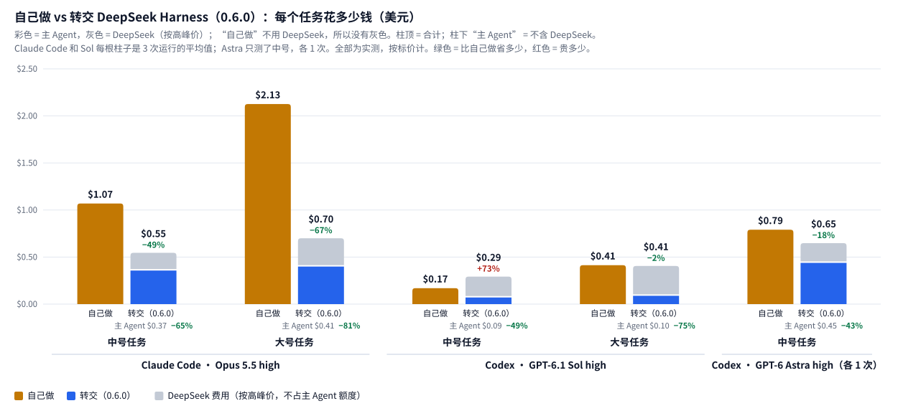

<p align="center">
  
</p>

<p align="center">
  <a href="README.md">English</a> | 中文
</p>

<p align="center">
  macOS · Windows（<a href="WINDOWS.md">说明</a>）· 不用装 Node.js · 零依赖 · MIT
</p>

Claude Code 和 Codex 各派一个任务给 DeepSeek Harness，它的子代理用 1 小时 41 分搭出了这条雨夜街道（40 秒，建议开声音）：

https://github.com/user-attachments/assets/ed931637-acb3-4c16-8c52-72298ea90485

<p align="center">
  
</p>

<p align="center">
  
</p>

## 实际演示

一个 Codex 对话里完成新建、排队、插队和等待：

<p align="center">
  
</p>

Codex 和 Claude 轮流往同一个 Harness 对话发消息，每条都标明是谁发的：

<p align="center">
  
</p>

<p align="center"><a href="docs/demos.zh-CN.md">更多演示 →</a></p>

## 快速上手

<p align="center">
  
</p>

需要：DeepSeek Harness ≥ 0.2.1-rc.2 并已登录；装了 Claude Code 或 Codex。别的都不用装，不用 Node.js，也不用开终端。macOS 和 Windows 步骤完全相同。

**1. 在 Harness 里添加插件：** 插件 → 添加插件 → 输入 `dsh-baton-host` → 安装 → 立即启用。

插件启用后会为 Claude Code 和 Codex 注册 dsh-baton（对所有文件夹生效），Harness 里会弹出提示。

**2. 检查：**在 Claude Code 或 Codex 里**新开**一个对话，让它调用 `dsh_list_workspaces`，会列出你的 Harness 工作区。

就这些。如果 Harness 提示没能注册，在终端运行 `npx -y dsh-baton-mcp setup`（这需要 Node.js ≥ 22.15），它做的是同样的注册。更新、卸载和 Windows 说明在[后面](#安装细节)。

## 工作原理

<p align="center">
  
</p>

<p align="center">
  
</p>

**各客户端怎么等待**（不需要配置）：
- **Claude Code** 在后台等待任务（`dsh_send` 返回的 `wait_command`），任务结束时只被唤醒一次。
- **Codex** 在 `dsh_wait` 里等待，每次最多 270 秒，刚好低于它 300 秒的工具超时。没做完时只返回状态，Codex 会直接再调用，不会去总结进度。Codex 不会收到 `wait_command`：它的终端无法在命令结束时唤醒它，只能轮询。
- Codex 调用 MCP 工具时会请你批准，批准 `dsh-baton` 的工具即可；无人值守的 `codex exec` 加上 `--approve-for-me`。

**转交之后怎么验收**（0.6.0 起）：客户端发任务时附上 `checks`，也就是项目自己的测试命令，比如 `npm test`。dsh-baton 在运行前记下文件夹里的文件，运行结束后自己列出新建、修改、删除了哪些文件，并自己跑一遍这些命令；这份 `evidence`（证据）来自 dsh-baton，不是 DeepSeek 的自述。消息末尾还会请 Harness 派一个只读子智能体，对照每条需求复查，最后附一张表（需求、是否满足、依据在哪个文件第几行）。客户端凭证据和这张表验收，没满足的一次性发回去修，只对没满足的行看代码。新开对话默认建在当前对话所在的文件夹，除非用 `cwd` 指定别的文件夹。

## Token 用量实测

2026-10-25/26 实测：用户用大白话提需求（末尾加一句「交给 DeepSeek Harness 去做」），两边用同一个模型，每格跑 3 次，每次都用同一套隐藏的验收脚本检查。下表是每个任务的平均花费，按标价计；DeepSeek 按高峰价，是最保守的算法：

| 任务 | Claude Code 自己做 | Claude Code → 0.6.0 | Codex 自己做 | Codex → 0.6.0 |
|---|---|---|---|---|
| 中号：命令行工具、分模块、测试 | $1.07 | 主 Agent $0.37，含 DeepSeek $0.55 | $0.17 | 主 Agent $0.09，含 DeepSeek $0.29 |
| 大号：网页应用、接口、测试 | $2.13 | 主 Agent $0.41，含 DeepSeek $0.70 | $0.41 | 主 Agent $0.10，含 DeepSeek $0.41 |

- **Claude Code** 自己的花费少 65–81%，加上 DeepSeek 后总价也只有自己做的一半左右甚至更少。
- **Codex**（gpt-6.1-sol，high）自己模型的花费少一半到四分之三，ChatGPT Plus 的 5 小时额度能多撑一倍以上：中号任务从 1.9% 降到 0.8%，大号从 4.3% 降到 1.0%。Sol 本身很便宜，加上 DeepSeek 后，中号的总价比 Codex 自己做还贵，大号基本持平；省下的是订阅额度。换成 GPT-6 Astra（high，中号任务，各跑 1 次），总价也省：自己做 $0.79，转交后 Codex 花 $0.45、含 DeepSeek $0.65，5 小时额度从 7% 降到 3%。
- 0.6.0 的 12 次运行全部一次通过验收。

[完整报告](./docs/benchmarks/token-usage-2026-10.md)里有方法、每一次运行、对比过的其他版本、原始数据和脚本。

<p align="center">
  
</p>

## 工具

<p align="center">
  
</p>

<p align="center">
  
</p>

<details>
<summary>完整工具说明</summary>

| 工具 | 作用 |
|---|---|
| `dsh_list_workspaces` | 列出 Harness 侧边栏里的工作区 |
| `dsh_create_workspace` | 把一个文件夹登记为工作区（文件夹不存在会先创建）；已登记的直接返回原来那个 |
| `dsh_list_sessions` | 列出对话（最新在前），带标题、目录、是否在跑；可按目录或关键字过滤。已归档的对话不会列出 |
| `dsh_read_session` | 读某个对话最近的消息和回复（含用到的工具名）；已归档的对话会带 `archived: true` |
| `dsh_send` | 发消息。带 `session_id` 续接那个对话；否则新开对话，建在 `cwd` 或 `workspace_id` 指定的位置，都不带时建在当前对话所在的文件夹（`cwd` 还不是工作区时会先登记；指定的 `cwd` 在当前对话文件夹之外也可以，结果里的 `folder_note` 会提醒）。`checks`：运行结束后 dsh-baton 自己跑的测试命令（见「转交之后怎么验收」）。立即返回 `run_id`。Harness 里这条消息会标注「由 Claude / ChatGPT 从另一个聊天发送」。已归档的对话会被拒绝：先在 Harness 里取消归档，或新开对话。对话正忙时，`mode` 为 `followup` 会排在当前回合之后，`steer` 会插进正在跑的回合；不传时跟随 Harness 自己的设置（设置 → 繁忙时的发送行为：排队发送或插话发送），读不到设置时按 `followup`。返回里的 `mode_source` 说明用的是哪种 |
| `dsh_status` | 查看运行进度：状态、最近的文字和工具调用、最终回复；回合结束但子智能体/后台任务还在跑时给出 `waiting_on`；中途有人在 Harness 界面里发消息时给出 `human_interjections`；被 Harness 重启打断的任务状态为 `interrupted` |
| `dsh_wait` | 等运行结束；发消息时带了 `checks` 的，结束后会附上 `evidence`（改了哪些文件、测试结果）（或者等到它停下来问人，见 `dsh_answer`）：Codex 每次最多等 270 秒，其他客户端 50 秒。没做完会带 `timed_out`，只返回状态，再调用一次即可。能在后台等待的客户端改用 `dsh_send` 返回的 `wait_command`。`dsh_status` 只用来看一眼，不用来等待 |
| `dsh_answer` | 回答运行中途提出的问题（Harness 的 ask_user_question）：每道题可以填选项编号或选项文字、自由填写，或者跳过；可以逐题回答，也可以一次答完。运行一提问，`dsh_wait` 和 `wait_command` 就会立刻返回，并带上题目（`needs_input`、`question`；Harness 那边模型推荐的选项单独放在 `harness_suggested` 里，不再写在选项文字中）。只有你说过让它自己决定时，助手才会按自己的判断回答，这时它会带上 `reason`，并告诉你选了什么、为什么；否则它会把题目转给你，开头先写它自己的建议和理由。你也可以直接在 Harness 窗口里回答，谁先答就算谁的 |
| `dsh_session_activity` | 对话此刻在做什么：正在跑的回合、子智能体（任意层级）、后台任务；已归档的对话会带 `archived: true` |
| `dsh_update_queued` | 按 `run_id` 修改还在忙碌对话队列里等待的消息：`edit` 改文字，`remove` 撤回，`steer` 立刻插进正在跑的回合。消息一旦进入对话就改不了了 |
| `dsh_cancel` | 按 `run_id` 或 `session_id` 停掉整个对话的工作：当前回合、子智能体、后台任务。Harness 会同时清掉队列里等待的消息，这些运行记为 `cancelled` |
| `dsh_rename_session` | 给对话改名 |
| `dsh_rename_workspace` | 给工作区改名（只改侧边栏标题，不动文件夹） |
| `dsh_list_runs` | 列出最近的运行，可按会话筛选 |
| `dsh_call` | 按名字调用任意 `dsh_*` 工具：0.6.0 起，不常用的工具（新建和重命名工作区、重命名对话、对话动态、修改排队消息、运行列表）不再出现在工具列表里，好让每次请求更短，改由这里调用；对话的工具列表还是更新前的旧版时也用它。名字不存在时会列出所有可用工具 |

</details>

## 命令行

```bash
dsh-baton workspaces
dsh-baton new-workspace ~/code/new-app --title "New App"
dsh-baton sessions --cwd ~/code/new-app
dsh-baton send --cwd ~/code/new-app "搭项目骨架"
dsh-baton send --session session-xxxx "继续：补上测试"
dsh-baton send --session session-xxxx --mode steer "插话：先别改 API"
dsh-baton wait hrun-xxxx              # 阻塞到结束，打印最终回复；成功退出码 0
dsh-baton status hrun-xxxx
dsh-baton activity session-xxxx       # 正在跑的回合、子智能体、后台任务
dsh-baton cancel --session session-xxxx
dsh-baton rename session-xxxx 新标题
dsh-baton rename-workspace ~/code/new-app 新名字
```

（从源码运行时用 `node src/cli.mjs …`。）

## 配置（环境变量）

| 变量 | 默认值 | 作用 |
|---|---|---|
| `DSH_BATON_BACKEND` | `auto` | `auto`、`host` 或 `headless` |
| `DSH_BATON_HOME` | `~/.dsh-baton` | 套接字和 headless 运行记录的位置 |
| `DSH_BATON_SOCKET` | `$DSH_BATON_HOME/host.sock` | 插件套接字路径（插件和 MCP 两边要一致）；Windows 上映射为按用户区分的命名管道，见 [WINDOWS.md](WINDOWS.md) |
| `DSH_BATON_WAIT_S` | Codex 为 `270`，其他为 `50` | 一次 `dsh_wait` 等多久；只有调大了客户端的工具超时才需要设，并且要小于那个超时 |
| `DSH_BIN` | macOS 应用内的 `dsh`，否则查 `PATH` | headless 模式用的 Harness 命令行 |
| `DSH_HOME` | `~/.dsh` | Harness 数据目录（headless 模式读取对话用） |
| `DSH_BATON_ACCOUNT` | `1` | headless 模式下设为 `0` 则改用 API key 路线 |
| `DSH_BATON_PATCHES` | 空 | headless 模式额外的 `--patch` 覆盖文件，用 `:` 分隔 |

<details>
<summary>headless 后备模式说明</summary>

插件不可用时，MCP 服务器会自动改用 Harness 自带的 `dsh headless` 命令。它只能续接自己新建的对话，不能续接桌面版里建的对话（headless 不加载 `standard` 等智能体预设）；新建的对话也不会出现在桌面版侧边栏。默认通过 [`patches/account.patch.yml`](patches/account.patch.yml) 沿用桌面版的 DeepSeek 账号登录，不需要 API key。

</details>

## 安装细节

**插件启用时做了什么。**它把 MCP 服务器复制到 `~/.dsh-baton/app` 这个固定的文件夹，再直接把 MCP 注册写进 `~/.claude.json` 和 `~/.codex/config.toml`，各留一份 `*.bak-dsh-baton` 备份。电脑上有 Node.js ≥ 22.15（在 `PATH` 里能找到）就用它启动服务器；没有的话，就用 Harness 自带的运行环境（Harness 应用本身以 Node 模式运行，`ELECTRON_RUN_AS_NODE=1`），不用另外安装任何东西。两种情况下，只装了桌面应用、`claude` / `codex` 不在 `PATH` 里也能用。每次 Harness 启动都会再检查一遍：已经正确的注册、或者指向另一份可用 dsh-baton 的注册，都不会改动。在 Harness 里输入包名后，安装源会自动切到「npm 官方源」（英文界面是 "Official npm registry"），不用另外选择，也不用重启。不想让插件自动注册，给 Harness 设置 `DSH_BATON_AUTO_REGISTER=0`。

**更新不用重启。**新版本装进 `~/.dsh-baton/app` 后（插件更新、`setup` 或手动复制），Claude Code 和 Codex 里已经开着的对话，下一次调用 `dsh_*` 工具时就会用上：服务器每次调用前检查这个文件夹，启动新版本，并在这次调用的结果里提示一次已经更新。正在进行的 `dsh_wait` 会先在旧版本里跑完。新版本启动失败时，旧版本继续工作，结果里会说明原因。新版本新增的工具，Claude Code 里马上就能用（服务器会通知客户端工具列表变了）；Codex 一直用对话开始时的工具列表，新工具要到下一个新对话才会显示；从 0.5.9 起，旧对话里也能通过 `dsh_call` 马上用上新功能（更新提示里会写明），已有的工具也会立刻用上新代码。这个功能从 0.5.8 之后的版本开始有效；由 0.5.8 或更早版本启动的服务器，还需要最后重启一次（或在 `/mcp` 里重新连接）。

**`npx -y dsh-baton-mcp setup`** 在终端里做同样的注册：用于插件没能注册的情况，或者从 MCP 目录过来的用户。插件已经注册过时它什么都不改；插件没装的话，它会提示去添加。

**更新。**Harness 只给官方插件提供"更新"按钮，所以要：插件 → dsh-baton-host → **卸载**，再**添加插件** → `dsh-baton-host`。新版本刚发布的一段时间里，Harness 会装上一个版本（pnpm 的 `minimumReleaseAge` 会暂缓刚发布的版本，安装弹窗里会说明）；想马上用新版，输入带版本号的名字：`dsh-baton-host@0.5.0`。重新启用后，插件会把 MCP 服务器也更新到同一版本，新开的对话就会用上。万一两边版本对不上，第一次发现不一致的工具调用会提示。

**卸载。**Harness → 插件 → dsh-baton-host → **卸载**，再运行 `npx -y dsh-baton-mcp setup --remove`。插件分不清"被卸载"和"Harness 退出"，所以 MCP 注册交给这条命令删，它也会删掉 `~/.dsh-baton/app`；运行记录留在 `~/.dsh-baton`，不需要的话自己删掉。

**从 dsh-bridge 升级。**在 Harness 里先卸载 `dsh-bridge-host`，再添加 `dsh-baton-host`；启用后它会替换掉旧的 `dsh-bridge` MCP 注册。`DSH_BRIDGE_*` 环境变量和已有的 `~/.dsh-bridge` 文件夹暂时继续可用。工具前缀变成 `mcp__dsh-baton__…`，权限白名单里写了旧前缀的要改一下。0.4 之前通过粘贴 `~/.dsh-baton/app/host` 装的插件仍然能用，但不会跟着 npm 更新：卸载它，再按包名添加 `dsh-baton-host`。

**从源码安装**（想跟进 `main` 或改代码）：`git clone https://github.com/JialaoLiu/dsh-baton.git`，然后在 Harness 里从克隆目录的 `host` 文件夹添加插件（添加插件 → 粘贴路径）。启用后注册的就是克隆目录本身，改动在发布前就能跑起来；更新用 `git pull`。在终端里运行 `node dsh-baton/src/cli.mjs setup` 也能注册克隆目录。

**Windows。**步骤相同；[WINDOWS.md](WINDOWS.md) 说明了不同之处（用命名管道代替套接字文件），以及插件页装不上或卸不掉时的修法。

<details>
<summary>手动注册与 Claude 桌面应用</summary>

插件和 `setup` 写入的内容和下面两条命令等价（用 `node` 的绝对路径，因为桌面应用启动 MCP 服务器时没有你 shell 的 `PATH`）：

```bash
claude mcp add dsh-baton -s user -- "$(command -v node)" "$PWD/dsh-baton/src/server.mjs"
codex mcp add dsh-baton -- "$(command -v node)" "$PWD/dsh-baton/src/server.mjs"
```

`-s user` 很关键：不加的话，Claude Code 只给当前项目文件夹注册。

**Claude 桌面应用（可选）**：聊天应用的连接器（和 Claude Code 是两回事），把下面这段加到 `~/Library/Application Support/Claude/claude_desktop_config.json`，然后重启应用，会显示为 "Local dev" 连接器。

```json
{ "mcpServers": { "dsh-baton": { "command": "/node 的绝对路径", "args": ["/dsh-baton 的绝对路径/src/server.mjs"] } } }
```

</details>

## 安全与限制

<p align="center">
  
</p>

<p align="center">
  
</p>

任何能以你的身份运行程序的进程都能通过这个套接字驱动 Harness，这和直接运行 `dsh` 的权限一样。本项目依赖 Harness 0.2.1 系列的内部服务接口，Harness 大版本更新后可能需要跟进。

<p align="center"><a href="docs/demos.zh-CN.md">更多演示 →</a></p>

## 许可证

MIT
