<p align="center">
  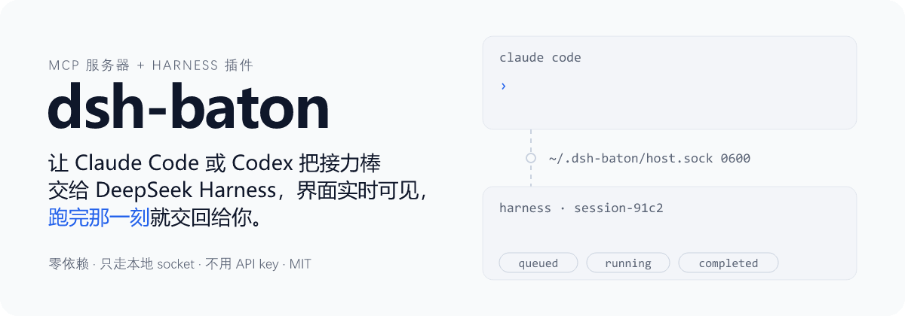
</p>

<p align="center">
  <a href="README.md">English</a> | 中文 · 原名 <b>dsh-bridge</b> · 非官方项目，与 DeepSeek 无关。
</p>

<p align="center">
  macOS · Windows（<a href="WINDOWS.md">说明</a>）· Node.js ≥ 22.15 · 零依赖 · MIT
</p>

<p align="center">
  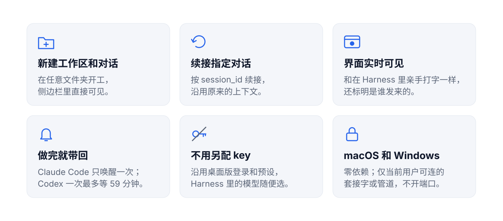
</p>

<p align="center">
  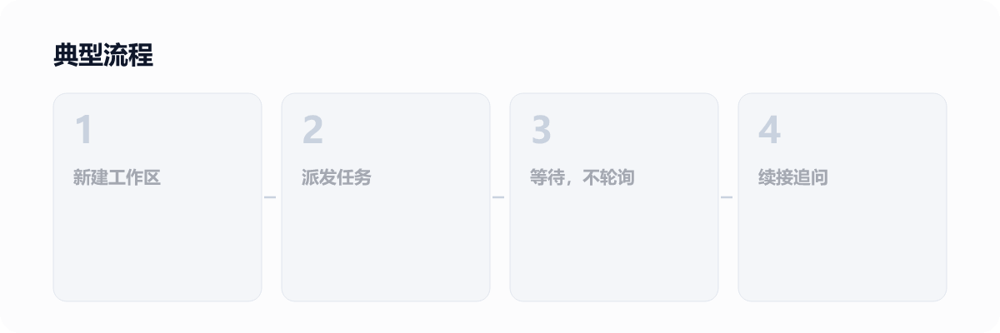
</p>

## 实际演示

一个 Codex 对话里完成新建、排队、插队和等待：

<p align="center">
  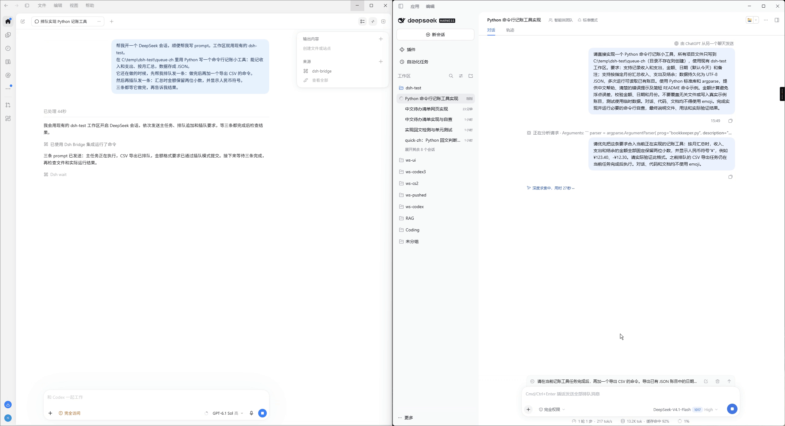
</p>

Codex 和 Claude 轮流往同一个 Harness 对话发消息，每条都标明是谁发的：

<p align="center">
  
</p>

<p align="center"><a href="docs/demos.zh-CN.md">更多演示 →</a></p>

## 快速上手

<p align="center">
  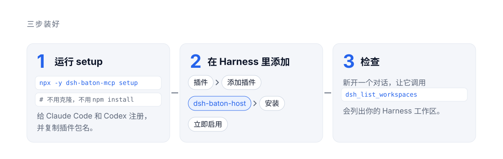
</p>

需要：DeepSeek Harness ≥ 0.2.1-rc.2 并已登录；Node.js ≥ 22.15。Windows 见 [WINDOWS.md](WINDOWS.md)。

**1. 运行 setup**，在终端里：

```bash
npx -y dsh-baton-mcp setup
```

dsh-baton 没有任何依赖。`setup` 会把自己复制到 `~/.dsh-baton/app` 这个固定的文件夹（npx 的缓存目录会变），然后在用户级别给 Claude Code 和 Codex 注册一次 MCP 服务器：之后在任何文件夹新开的对话都有 `dsh_*` 工具。它直接写 `~/.claude.json` 和 `~/.codex/config.toml`（各留一份 `*.bak-dsh-baton` 备份），所以只装了桌面应用、`claude` / `codex` 不在 `PATH` 里也能用。重复运行也没问题。

**2. 在 Harness 里粘贴。**`setup` 已经把插件文件夹路径复制到剪贴板：

**插件** → **添加插件** → 粘贴 → **安装** → **立即启用**

**3. 检查。**在 Claude Code 或 Codex 里**新开**一个对话，让它调用 `dsh_list_workspaces`，应该会列出你的 Harness 工作区。

**也可以让 Claude Code 或 Codex 帮你装：** 发给它 *"运行 `npx -y dsh-baton-mcp setup`，然后告诉我它提示的 Harness 那一步。"*

**各客户端怎么等待**（不需要配置）：
- **Claude Code** 在后台等待任务（`dsh_send` 返回的 `wait_command`），任务结束时只被唤醒一次。
- **Codex** 在 `dsh_wait` 里等待，每次最多 270 秒，刚好低于它 300 秒的工具超时。没做完时只返回状态，Codex 会直接再调用，不会去总结进度。Codex 不会收到 `wait_command`：它的终端无法在命令结束时唤醒它，只能轮询。
- Codex 调用 MCP 工具时会请你批准，批准 `dsh-baton` 的工具即可；无人值守的 `codex exec` 加上 `--approve-for-me`。

**更新：** 再运行一次 `npx -y dsh-baton-mcp@latest setup`，然后重启 Harness 以加载插件改动；新开的对话会用上 MCP 服务器的改动。

**卸载：** `npx -y dsh-baton-mcp setup --remove`，再到 Harness → 插件 → dsh-baton-host → 卸载，最后再运行一次 `setup --remove` 删除 `~/.dsh-baton/app`。

**从 dsh-bridge（旧名）升级：**照上面运行 `setup`。它会替换掉旧的 `dsh-bridge` MCP 注册；在 Harness 里先卸载 `dsh-bridge-host`，再添加新路径。`DSH_BRIDGE_*` 环境变量和已有的 `~/.dsh-bridge` 文件夹暂时继续可用。工具前缀变成 `mcp__dsh-baton__…`，权限白名单里写了旧前缀的要改一下。

**从源码安装**（想跟进 `main` 或改代码）：`git clone https://github.com/JialaoLiu/dsh-baton.git`，再运行 `node dsh-baton/src/cli.mjs setup`。这时 setup 注册的就是克隆目录本身，更新用 `git pull`。

<details>
<summary>手动注册与 Claude 桌面应用</summary>

`setup` 写入的内容和下面两条命令等价（用 `node` 的绝对路径，因为桌面应用启动 MCP 服务器时没有你 shell 的 `PATH`）：

```bash
claude mcp add dsh-baton -s user -- "$(command -v node)" "$PWD/dsh-baton/src/server.mjs"
codex mcp add dsh-baton -- "$(command -v node)" "$PWD/dsh-baton/src/server.mjs"
```

`-s user` 很关键：不加的话，Claude Code 只给当前项目文件夹注册。

**Claude 桌面应用（可选）**：聊天应用的连接器（和 Claude Code 是两回事），把下面这段加到 `~/Library/Application Support/Claude/claude_desktop_config.json`，然后重启应用，会显示为 "Local dev" 连接器。

```json
{ "mcpServers": { "dsh-baton": { "command": "/node 的绝对路径", "args": ["/dsh-baton 的绝对路径/src/server.mjs"] } } }
```

</details>

## 工作原理

<p align="center">
  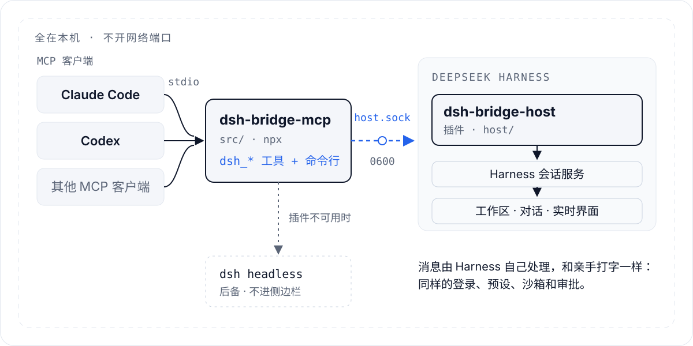
</p>

<p align="center">
  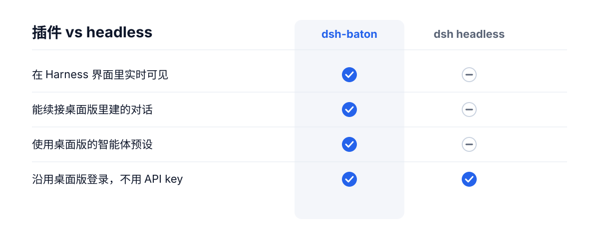
</p>

## 工具

<p align="center">
  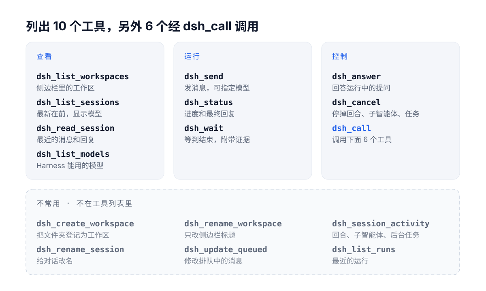
</p>

<p align="center">
  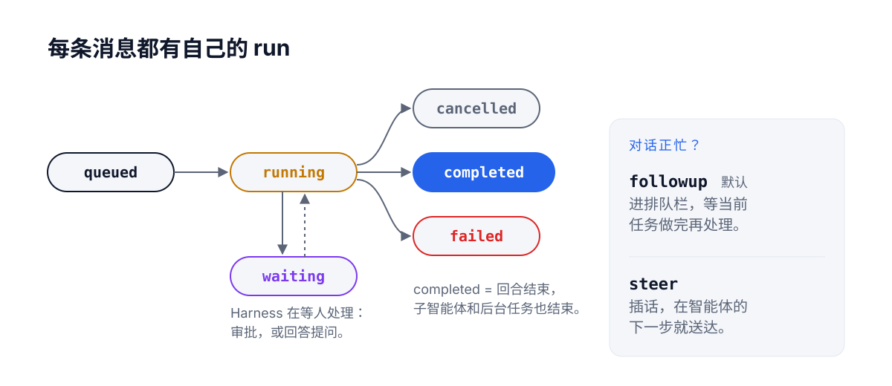
</p>

<details>
<summary>完整工具说明</summary>

| 工具 | 作用 |
|---|---|
| `dsh_list_workspaces` | 列出 Harness 侧边栏里的工作区 |
| `dsh_create_workspace` | 把一个文件夹登记为工作区（文件夹不存在会先创建）；已登记的直接返回原来那个 |
| `dsh_list_sessions` | 列出对话（最新在前），带标题、目录、是否在跑；可按目录或关键字过滤。已归档的对话不会列出 |
| `dsh_read_session` | 读某个对话最近的消息和回复（含用到的工具名）；已归档的对话会带 `archived: true` |
| `dsh_send` | 发消息。带 `session_id` 续接那个对话；带 `cwd` 或 `workspace_id` 新开对话（`cwd` 还不是工作区时会先登记）。立即返回 `run_id`。Harness 里这条消息会标注「由 Claude / ChatGPT 从另一个聊天发送」。已归档的对话会被拒绝：先在 Harness 里取消归档，或新开对话 |
| `dsh_status` | 查看运行进度：状态、最近的文字和工具调用、最终回复；回合结束但子智能体/后台任务还在跑时给出 `waiting_on`；中途有人在 Harness 界面里发消息时给出 `human_interjections`；被 Harness 重启打断的任务状态为 `interrupted` |
| `dsh_wait` | 等运行结束：Codex 每次最多等 270 秒，其他客户端 50 秒。没做完会带 `timed_out`，只返回状态，再调用一次即可。能在后台等待的客户端改用 `dsh_send` 返回的 `wait_command`。`dsh_status` 只用来看一眼，不用来等待 |
| `dsh_session_activity` | 对话此刻在做什么：正在跑的回合、子智能体（任意层级）、后台任务；已归档的对话会带 `archived: true` |
| `dsh_cancel` | 按 `run_id` 或 `session_id` 停掉整个对话的工作：当前回合、子智能体、后台任务（排队中的消息不会被删） |
| `dsh_rename_session` | 给对话改名 |
| `dsh_rename_workspace` | 给工作区改名（只改侧边栏标题，不动文件夹） |
| `dsh_list_runs` | 列出最近的运行 |

</details>

## 命令行

```bash
dsh-baton workspaces
dsh-baton new-workspace ~/code/new-app --title "New App"
dsh-baton sessions --cwd ~/code/new-app
dsh-baton send --cwd ~/code/new-app "搭项目骨架"
dsh-baton send --session session-xxxx "继续：补上测试"
dsh-baton send --session session-xxxx --mode steer "插话：先别改 API"
dsh-baton wait hrun-xxxx              # 阻塞到结束，打印最终回复；成功退出码 0
dsh-baton status hrun-xxxx
dsh-baton activity session-xxxx       # 正在跑的回合、子智能体、后台任务
dsh-baton cancel --session session-xxxx
dsh-baton rename session-xxxx 新标题
dsh-baton rename-workspace ~/code/new-app 新名字
```

（从源码运行时用 `node src/cli.mjs …`。）

## 配置（环境变量）

| 变量 | 默认值 | 作用 |
|---|---|---|
| `DSH_BATON_BACKEND` | `auto` | `auto`、`host` 或 `headless` |
| `DSH_BATON_HOME` | `~/.dsh-baton` | 套接字和 headless 运行记录的位置 |
| `DSH_BATON_SOCKET` | `$DSH_BATON_HOME/host.sock` | 插件套接字路径（插件和 MCP 两边要一致）；Windows 上映射为按用户区分的命名管道，见 [WINDOWS.md](WINDOWS.md) |
| `DSH_BATON_WAIT_S` | Codex 为 `270`，其他为 `50` | 一次 `dsh_wait` 等多久；只有调大了客户端的工具超时才需要设，并且要小于那个超时 |
| `DSH_BIN` | macOS 应用内的 `dsh`，否则查 `PATH` | headless 模式用的 Harness 命令行 |
| `DSH_HOME` | `~/.dsh` | Harness 数据目录（headless 模式读取对话用） |
| `DSH_BATON_ACCOUNT` | `1` | headless 模式下设为 `0` 则改用 API key 路线 |
| `DSH_BATON_PATCHES` | 空 | headless 模式额外的 `--patch` 覆盖文件，用 `:` 分隔 |

<details>
<summary>headless 后备模式说明</summary>

插件不可用时，MCP 服务器会自动改用 Harness 自带的 `dsh headless` 命令。它只能续接自己新建的对话，不能续接桌面版里建的对话（headless 不加载 `standard` 等智能体预设）；新建的对话也不会出现在桌面版侧边栏。默认通过 [`patches/account.patch.yml`](patches/account.patch.yml) 沿用桌面版的 DeepSeek 账号登录，不需要 API key。

</details>

## 安全与限制

<p align="center">
  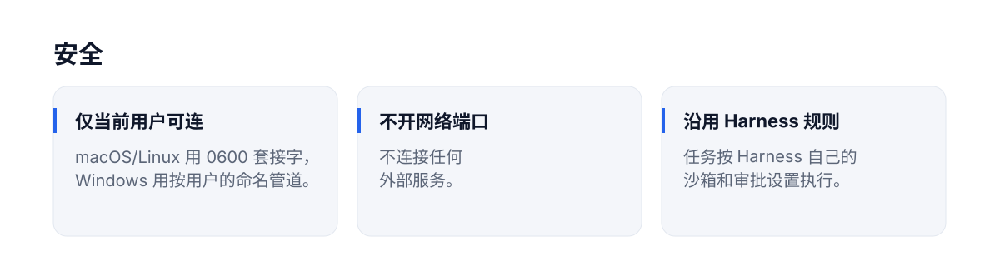
</p>

<p align="center">
  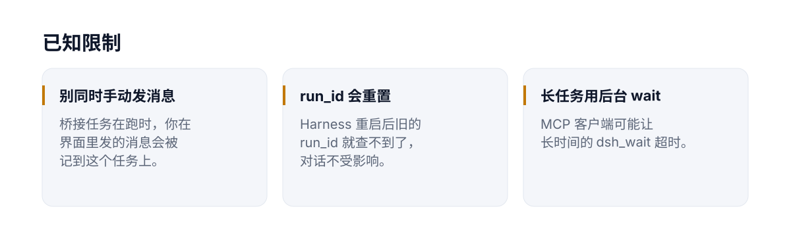
</p>

任何能以你的身份运行程序的进程都能通过这个套接字驱动 Harness，这和直接运行 `dsh` 的权限一样。本项目依赖 Harness 0.2.1 系列的内部服务接口，Harness 大版本更新后可能需要跟进。

<p align="center"><a href="docs/demos.zh-CN.md">更多演示 →</a></p>

## 许可证

MIT
