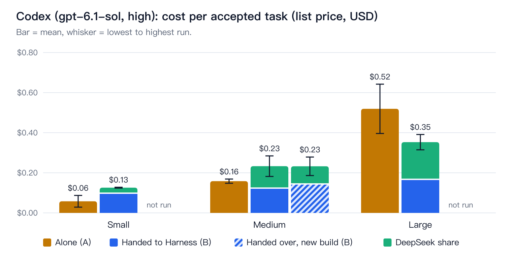
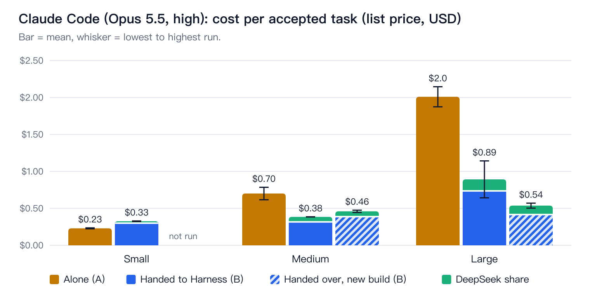
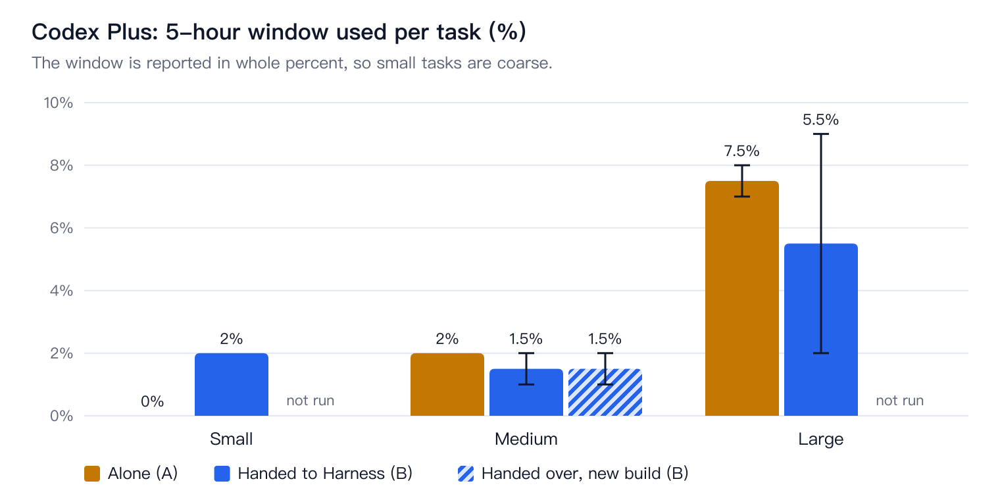
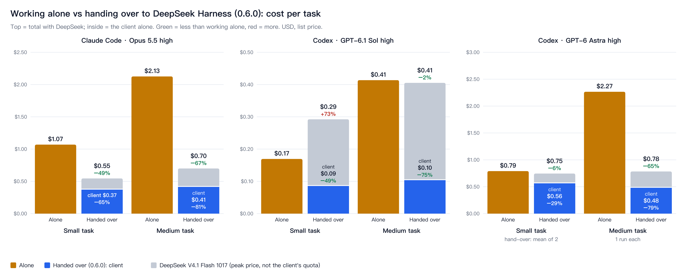
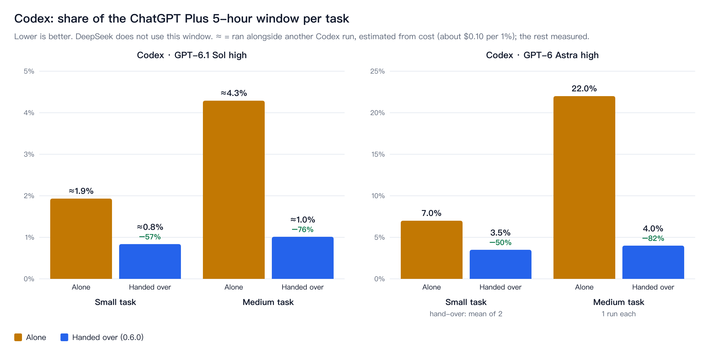

# Token usage: doing a task alone vs handing it to DeepSeek Harness (October 2026)

A commenter asked whether handing work to Harness through dsh-baton actually saves tokens, and the earlier "saves a lot" numbers in the promo video were animation values, not measurements. This is the first measurement. It covers 31 runs on macOS on 2026-10-25.

**Short answer:** it depends on the size of the task.

- **Small tasks (one file, a few minutes): handing over costs more.** Codex: $0.13 vs $0.06 per task. Claude Code: $0.33 vs $0.23. The fixed cost of a hand-over (finding the workspace, sending, waiting, reviewing) is larger than the work it takes off the client.
- **Medium tasks (several files and tests): it splits by client.** Claude Code saves 45% ($0.39 vs $0.70). Codex costs more in total ($0.23 vs $0.16), though its own GPT share is a little lower ($0.13 vs $0.16) and its Plus 5-hour window use is about the same.
- **Large tasks (a small multi-module web app): handing over saves on both clients.** Claude Code: $0.89 vs $2.01 (−56%). Codex: $0.35 vs $0.52 (−32%). Codex's clean large run used 2% of the Plus 5-hour window, against 7–8% when Codex did the task alone.

Every run passed the same hidden acceptance check, so these are costs per accepted task.

**Update, 2026-10-26: a second round with plain-language requests led to dsh-baton 0.6.0.** See [Round 2](#round-2-plain-language-requests-and-060). In short, with 0.6.0 Claude Code spends 65–81% less of its own model on the small and medium tasks of that round, Codex (GPT-6.1 Sol) 49–75% less, and a ChatGPT Plus 5-hour window covers 2 to 4 times as many tasks. For small tasks Sol on its own is still cheaper in total once DeepSeek is counted, and at medium size it is about even.

## How it was measured

**Tasks.** There is one task type, a task tracker, in three sizes. Each size has a written spec and a hidden acceptance check that the agents never see:

| Size | What is built | Acceptance check |
|---|---|---|
| small | `todo.mjs`, a one-file CLI | 14 checks on output and exit codes ([checks/small.mjs](token-usage-2026-10/checks/small.mjs)) |
| medium | CLI split into storage, logic and CLI modules, ≥ 8 tests | `npm test` plus 27 checks on sorting, filters, stats and CSV export ([checks/medium.mjs](token-usage-2026-10/checks/medium.mjs)) |
| large | HTTP API, static front end, ≥ 10 tests, README | `npm test`, static-file checks and 30 API checks against a live server ([checks/large.mjs](token-usage-2026-10/checks/large.mjs)) |

The page itself in the large task is checked statically (labels, viewport, the API calls in `app.js`), not in a browser.

**Arms.**
- **Arm A:** the client does the task alone, with dsh-baton not loaded.
- **Arm B:** same prompt plus one last line, `交给 DeepSeek Harness。` (hand it to DeepSeek Harness), with dsh-baton 0.5.9 loaded.

The prompts are in [prompts/](token-usage-2026-10/prompts).

**What is held the same.**

| Held constant | Codex | Claude Code |
|---|---|---|
| Model | gpt-6.1-sol, reasoning effort high | Claude Opus 5.5, effort high |
| How it runs | `codex exec` | `claude -p` |

- Both arms use the same model and the same prompt, apart from that last line.
- Every run starts in a new conversation, in its own new empty folder.
- On the Harness side, DeepSeek runs `deepseek-flash` with the user's normal Harness settings.

**Rework.** If the acceptance check fails, the failures go back into the same conversation, at most twice. One run needed this (Claude Code, large, arm B, run 2: 8 tests instead of 10).

**Runs.** Each size and arm ran twice per client. One Codex arm B run is excluded (see below) and was replaced.

**Data sources.**

| Side | Where the numbers come from |
|---|---|
| Codex | The last `token_count` event in the run's `~/.codex/sessions` rollout: input, cached input, output, reasoning. The same events carry the Plus 5-hour window `used_percent`. |
| Claude Code | `usage` and `modelUsage` from `claude -p --output-format json`. Tool calls are counted from the transcript. |
| DeepSeek | The `usage` that Harness records on every assistant message in the session file. This is listed separately and never counted as GPT or Claude tokens. |

**Prices.** USD per million tokens, list prices on 2026-10-25:

| Model | Input | Cached input | Output |
|---|---|---|---|
| gpt-6.1-sol | $2 | $0.10 | $10 |
| Claude Opus 5.5 | $4 | $0.20 read, $8 one-hour write | $20 |
| deepseek-flash, peak | $0.30 | $0.006 | $1.20 |

- Claude Code's own cost figure is used as reported. It matches these prices to the cent.
- A ChatGPT Plus or Claude subscription is not billed in dollars. Its usage meters weigh the same three token kinds in a similar way, so the dollar ratios approximate the quota ratios.

## Results

### Cost per accepted task (mean of two runs; range in brackets)

| Client | Size | Arm | Build | Runs | Own model | DeepSeek | Total | Codex Plus 5-hour window, per run |
|---|---|---|---|---|---|---|---|---|
| Codex | small | A | 0.5.9 | 2 | $0.058 | - | **$0.058** (0.03–0.09) | 0%, 0% |
| Codex | small | B | 0.5.9 | 2 | $0.102 | $0.024 | **$0.126** (0.12–0.13) | 2%, 2% |
| Codex | medium | A | 0.5.9 | 2 | $0.158 | - | **$0.158** (0.15–0.17) | 2%, 2% |
| Codex | medium | B | 0.5.9 | 2 | $0.127 | $0.106 | **$0.233** (0.18–0.28) | 1%, 2% |
| Codex | medium | B | trimmed | 2 | $0.148 | $0.085 | **$0.232** (0.19–0.28) | 2%, 1% |
| Codex | large | A | 0.5.9 | 2 | $0.519 | - | **$0.519** (0.40–0.64) | 8%, 7% |
| Codex | large | B | 0.5.9 | 2 | $0.171 | $0.182 | **$0.353** (0.31–0.39) | 9%\*, 2% |
| Claude Code | small | A | 0.5.9 | 2 | $0.230 | - | **$0.230** (0.22–0.24) | - |
| Claude Code | small | B | 0.5.9 | 2 | $0.311 | $0.015 | **$0.326** (0.32–0.33) | - |
| Claude Code | medium | A | 0.5.9 | 2 | $0.701 | - | **$0.701** (0.62–0.79) | - |
| Claude Code | medium | B | 0.5.9 | 2 | $0.328 | $0.057 | **$0.385** (0.38–0.39) | - |
| Claude Code | medium | B | trimmed | 2 | $0.398 | $0.062 | **$0.460** (0.44–0.48) | - |
| Claude Code | large | A | 0.5.9 | 2 | $2.010 | - | **$2.010** (1.87–2.15) | - |
| Claude Code | large | B | 0.5.9 | 2 | $0.747 | $0.146 | **$0.892** (0.64–1.14) | - |
| Claude Code | large | B | trimmed | 2 | $0.426 | $0.111 | **$0.537** (0.50–0.57) | - |

The "trimmed" build is described under [A trimmed build](#a-trimmed-build).

\* **The 9% is not all this run's.** In this run, the window rose by 6 points between 08:58 and 09:00, while the run was idle waiting on Harness: in that time it sent one request of about 33,000 tokens, almost all of them cached. Other Codex use on the same account during that time (a Windows verification run) is the likely cause. The second large run, with nothing else on the account, used 2%.

The window is reported in whole percent. In these runs, about $0.08 of gpt-6.1-sol at list price matched one point of the Plus 5-hour window. For example, medium alone cost $0.16 and used 2%; large alone cost $0.64 and used 8%.

### Tokens

Token counts per size and arm are in [results/tables.md](token-usage-2026-10/results/tables.md). The pattern behind the costs:

- **Arm B always reads more cached input on small and medium tasks.** Codex small: 307k vs 94k input tokens. Each round of a hand-over (send, wait, review) re-reads the whole conversation, and those reads are cached and cheap but not free.
- **Arm B writes much less output.** Codex medium: 1.6k vs 9.6k output tokens. Claude Code large: 8.8k vs 55k. Output is the most expensive token kind, and this is where the savings come from.
- **On large tasks, arm A's context keeps growing.** Codex alone took 25 requests and its context grew from 27k to 113k tokens; each request re-reads all of it, giving 1.58M input in total. Handed over, it took 10 requests and 430k input.
- **DeepSeek does most of the reading.** On a large task it read 2.8–8.3M tokens, almost all from its cache, and wrote 66–105k tokens. At deepseek-flash prices that is $0.11–0.19.

**Wall time.**
- Small and medium: arm B was slower (Codex medium: 639 s vs 137 s).
- Large: about the same.

How long the Harness side takes varies a lot from run to run: one Codex medium hand-over took 12 minutes, another 4.

## Why a hand-over has a fixed cost

These were seen in the run logs.

1. **Every round re-reads the conversation.** A hand-over adds at least four rounds: find or create the workspace, send, wait, review. Each one re-reads the full context. On a task the client would finish in 3–4 requests, those rounds cost more than the work they save.
2. **Codex reads the tool catalogue first.** Its first step is often to list all its tools filtered for "harness". With 0.5.9 this returned all 15 dsh-baton tools with full descriptions (about 17k characters), and that text stays in context for the rest of the conversation.
3. **The client reviews the result, and sometimes sends it back.** Codex sent work back to Harness in 4 of its 8 valid arm B runs. Each time it named a specific gap that the hidden check did not test:
   - **Small:** text was trimmed of leading and trailing spaces, although the spec only says to join the words.
   - **Medium, run 1:** a "pure logic" module read the system clock.
   - **Medium, trimmed build:** `--due ''` was accepted as an empty date.
   - **Large:** ids were reused after the highest one was deleted, a tag literally named `all` could not be filtered, and years 0000–0099 were rejected as invalid dates.

   Claude Code sent nothing back. In large run 1 it read the generated source, and in the other runs it checked by running the code and the tests. This review is part of the value of the hand-over. It costs one more round on each side.
4. **Waiting is cheap.** A `dsh_wait` round re-reads a context that is nearly all cached: under $0.004 per round on Codex.

## A trimmed build

After the first round of results, a trimmed build of dsh-baton was tested on arm B (Codex medium, Claude Code medium and large, two runs each). It was not released. Its changes:

- **Shorter tool descriptions.** `tools/list` went from 16.8k to 12.0k characters.
- **Shorter results.** A finished `dsh_wait` result drops the event log (`dsh_status` still has it), and results are compact JSON.
- **A review hint with the result:** review it against each requirement, run the tests, read the files those requirements touch, and send all fixes back in one message.

What happened:

| | 0.5.9 | Trimmed | Change |
|---|---|---|---|
| Codex medium, B | $0.233 | $0.232 | none |
| Claude Code medium, B | $0.385 | $0.460 | +19% |
| Claude Code large, B | $0.892 ($0.642 without the rework run) | $0.537 | −40% (−16%) |

- **The shorter descriptions and results saved little.** Once read, they are served from cache at a tenth of the price. This matches what the FirstStrike game MCP found: fewer calls matter far more than shorter text.
- **The review hint moved Claude Code from "run the tests" to "run the tests and read the code".** In the medium runs under 0.5.9, Claude Code never opened the generated source. With the hint, it read every source file and, in one run, fixed an id-reuse bug itself. That costs more on medium tasks and buys a better review.
- **No trimmed run needed rework.** The −16% on large comes with no rework in either build and is within run-to-run noise at two runs.

The trimmed build is a trade between review depth and cost, not a clear saving. Whether to keep the review hint is a product decision.

## Excluded run

In one Codex arm B run (large, run 2), Codex ignored the hand-over line and built the whole project itself, without a single dsh-baton call. It passed the check, but it is not an arm B result. The raw data keeps it, marked `valid: false`, the tables leave it out, and a third run replaced it.

That is 1 of 9 Codex arm B attempts. Claude Code handed over every time.

## Suggestions (not yet changed)

- **Route by task size.** Do small single-file tasks directly, and hand over medium or larger work. This matters most for Claude Code, where Opus output is expensive, and for Codex on large tasks.
- **Cut rounds, not text.** The two cheap levers left are:
  - **Acceptance checks run by dsh-baton itself.** For example, `dsh_send` takes a test command; dsh-baton runs it locally when the run ends and returns pass/fail and the last lines of output. The client then reviews from evidence without a model round.
  - **A change summary in the final result.** Files changed and lines added or removed, so a review can go straight to the right files.
- **Keep the review.** It found real defects the hidden checks missed. Sending all fixes back in one message keeps it to one extra round.

## Limits

- Two runs per cell. Run-to-run spread is often larger than the difference between builds; the brackets show it.
- One task type, generated by models on a clean folder. Work in a large existing codebase may behave differently. Most likely the client then reads more of the codebase alone, which favours handing over.
- The large task's page was not tested in a browser.
- The "app.js calls the API" check looks for the literal paths `/api/tasks` and `/api/stats`, so it can fail code that builds the path another way.
- Codex Plus quota is reported in whole percent and is shared by everything on the account.
- Prices are list prices on one day. DeepSeek's off-peak price is half the peak price used here.

## Round 2: plain-language requests and 0.6.0

Task sizes: these two tasks were first called medium and large. After the runs they were renamed small and medium, because the smaller one took the client only about 7–8 minutes on its own; the file names and the raw data keep the old names (`natural/medium.md` is the small task, `natural/large.md` the medium one). Round 1's sizes are different tasks and keep their names.

Round 1 gave the client a precise spec. Users do not write those, so round 2 used plain requests, the way a user talks, and let the client turn them into a spec: [natural/medium.md](token-usage-2026-10/natural/medium.md) (a command-line task manager with modules and tests) and [natural/large.md](token-usage-2026-10/natural/large.md) (a small web app: Node server, REST API, page, tests). The hand-over arm adds only "交给 DeepSeek Harness 去做。" at the end. The checks test behaviour, not exact output: [checks/natural-medium.mjs](token-usage-2026-10/checks/natural-medium.mjs), [checks/natural-large.mjs](token-usage-2026-10/checks/natural-large.mjs). Same models as round 1, three runs per cell (Astra: one), list prices, DeepSeek V4.1 Flash 1017 at its peak price. The live log of every batch is [LOG.md](token-usage-2026-10/LOG.md); problems found are in [bugs.yml](token-usage-2026-10/bugs.yml).

Builds compared, all from the same request: working alone; the 0.5.9 hand-over; **evidence** (dsh-baton runs the client's checks itself and reports the files changed); **lean evidence** (evidence, with wording that keeps the client from writing its own check scripts); **review table** (lean evidence, plus a read-only Harness sub-agent that checks every requirement and ends with a table). The review-table build is 0.6.0.

Cost per task: the client's own model, and the total with DeepSeek. Reworks are the extra rounds the hidden check asked for, per run.

| Claude Code · Opus 5.5 high | Runs | Small: client | Small: total | Reworks | Runs | Medium: client | Medium: total | Reworks |
|---|---|---|---|---|---|---|---|---|
| Alone | 3 | $1.07 | $1.07 | 0, 0, 0 | 2 | $2.13 | $2.13 | 0, 0 |
| 0.5.9 hand-over | 4 | $0.36 | $0.49 | 0, 0, 0, 0 | 3 | $0.47 | $0.63 | 0, 0, 0 |
| Evidence | 1 | $0.55 | $0.69 | 0 | – | – | – | – |
| Lean evidence | 3 | $0.40 | $0.54 | 0, 0, 0 | 3 | $0.55 | $0.77 | 1, 0, 0 |
| **Review table (0.6.0)** | 3 | **$0.37** | **$0.55** | 0, 0, 0 | 3 | **$0.41** | **$0.70** | 0, 0, 0 |

| Codex · GPT-6.1 Sol high | Runs | Small: client | Small: total | Reworks | Runs | Medium: client | Medium: total | Reworks |
|---|---|---|---|---|---|---|---|---|
| Alone | 3 | $0.17 | $0.17 | 0, 0, 0 | 3 | $0.41 | $0.41 | 0, 0, 0 |
| 0.5.9 hand-over | 3 | $0.21 | $0.54 | 1, 0, 1 | 3 | $0.14 | $0.35 | 0, 0, 0 |
| Evidence | 3 | $0.08 | $0.23 | 0, 0, 0 | 3 | $0.09 | $0.31 | 0, 0, 0 |
| **Review table (0.6.0)** | 3 | **$0.09** | **$0.29** | 0, 0, 0 | 3 | **$0.10** | **$0.41** | 0, 0, 0 |

Codex with GPT-6 Astra high, each run on its own: small alone $0.79 and 7% of the Plus 5-hour window; handed over to 0.6.0 (mean of 2 runs, $0.45 and $0.67) $0.56 for Codex, $0.75 with DeepSeek, 3.5% of the window. Medium alone $2.27 and 22%; handed over $0.48 for Codex, $0.78 with DeepSeek, 4%. The dearer small run had two more waits and lost the provider's prompt cache after one of them.

Plus 5-hour window per task with Sol: small 1.9% alone vs 0.8% with 0.6.0, medium 4.3% vs 1.0%. Runs that overlapped another Codex run share the account-wide window, so their share is estimated from GPT cost at the ratio measured on runs that ran alone (about $0.10 per 1%; Astra measured $0.11–0.15 per 1%, so the window tracks list price).

**What changed between builds, and why 0.6.0 is the review-table build.**
- Evidence cut Codex's own cost most: fewer and shorter waits, no reading the folder. On Claude Code it cost more than 0.5.9, because Claude wrote its own check scripts and reproduced failures before sending fixes. The lean wording stopped that (no script was written in six runs).
- The review table kept Codex near the evidence build and brought Claude Code to its lowest large-task cost ($0.41), and all 12 runs passed the hidden check the first time. The client read the table and the evidence instead of the code. The DeepSeek share rises by about a third for the extra review.
- The review still catches things: in one evidence run all checks passed and Codex sent back a wrong number in the README on its own; in the Windows check of 0.6.0-next.0 the Harness review found and fixed a prototype-key validation bug.
- A courier build (a cheap sub-agent of the client relays the hand-over) cost more for Codex, whose main thread polled the sub-agent (65 sleep calls in one medium run). It was dropped.

**Not counted, and why** (all kept in the raw data with `valid: false` or left out by date):
- Medium runs that ended before the medium check was fixed (bug 7): the check guessed field names (`due`, `text`) the request never named and showed only the fallback's error, so every build got one or two false reworks.
- A batch run while the DeepSeek balance ran out: Codex retried and did work itself, using about 17% of the window.
- The Astra medium hand-over, stopped at 99% of the window before it ended.

**Limits.** Three runs per cell (one for Astra); small and medium tasks only; one kind of project, built from an empty folder; the page of the medium task was not tested in a browser. Codex desktop overhead was not measured: one test conversation in the Codex app sent about 12k more input tokens per request than the CLI, mostly cached.

## Reproduce and check

All scripts are in [token-usage-2026-10/](token-usage-2026-10/):

| Script | What it does |
|---|---|
| `run.mjs --client codex\|claude [--sizes] [--arms] [--reps] [--label]` | runs and checks one client |
| `summarize.mjs` | writes `results/runs.csv`, `results/summary.json` and `results/tables.md` |
| `charts.mjs [--zh]` | draws the charts |
| `archive.mjs` | copies each run's raw files out of the repo and writes `results/evidence.json` |
| `measure-tools.mjs` | prints the size of the tool list a client receives |
| `run.mjs --tasks natural [--server <server.mjs>] [--model gpt-6-astra]` | round 2: the plain-language requests, a given dsh-baton build, another Codex model |
| `charts-natural.mjs [--zh] [--combined]` | round 2 charts |
| `evidence-chain.mjs [--en]` | the evidence chain of one real run |

**Raw data in the repo:**

| File | Contents |
|---|---|
| `results/codex.jsonl`, `results/claude.jsonl` | one line per 0.5.9 run |
| `results/codex-v2.jsonl`, `results/claude-v2.jsonl` | one line per trimmed-build run |
| `results/runs.csv` | every run, flattened |
| `results/evidence.json` | every Codex `token_count` line, plus the SHA256 of each archived raw file |

The raw rollouts, transcripts, Harness session files and finished workspaces were archived outside the repo, because they contain account ids and system prompts. The SHA256 in `results/evidence.json` lets anyone holding those files check them.
