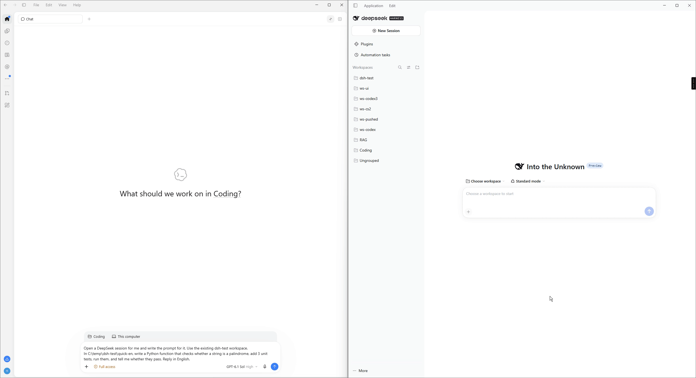
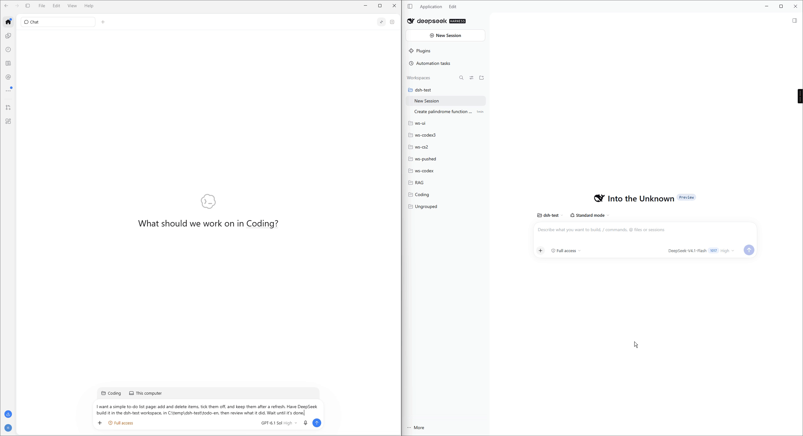
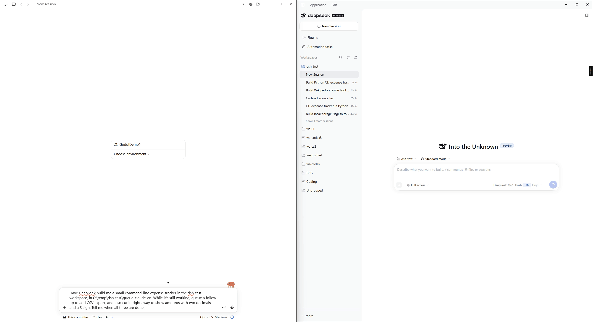
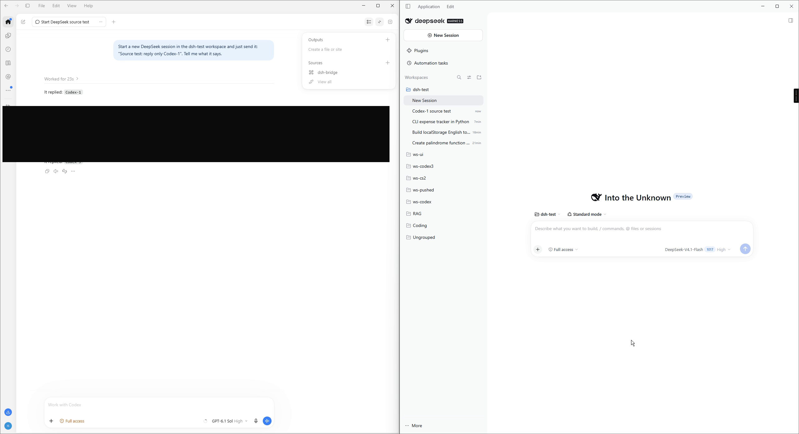
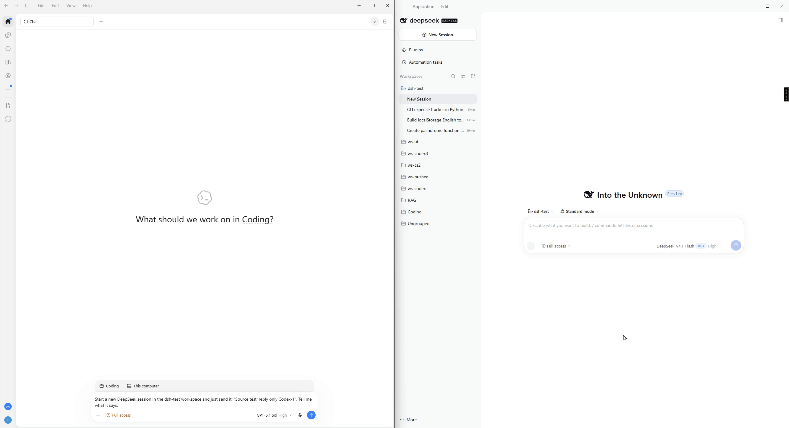

# dsh-baton demos

English | [中文](demos.zh-CN.md) · [Back to README](../README.md)

Each demo shows the calling agent on the left and DeepSeek Harness on the right. Waits are sped up.

## Quick task from Codex

Codex desktop opens a DeepSeek session, has it write a palindrome function and 3 tests, runs them and reports the result.

  

## Long task, wait, then review

DeepSeek builds a to-do list web page. Codex waits until it is done, then reviews the result.

  

## Queue and steer from Claude Code

Claude Code starts a task, queues a follow-up and steers the running turn.

  

## Cancel from the Codex CLI

The Codex CLI sends a task and cancels it at once with `dsh_cancel`. The run ends as `cancelled`.

  

## Codex and Claude in one session

Codex and Claude take turns sending to the same Harness session. This is the full version with the Codex window.

  

