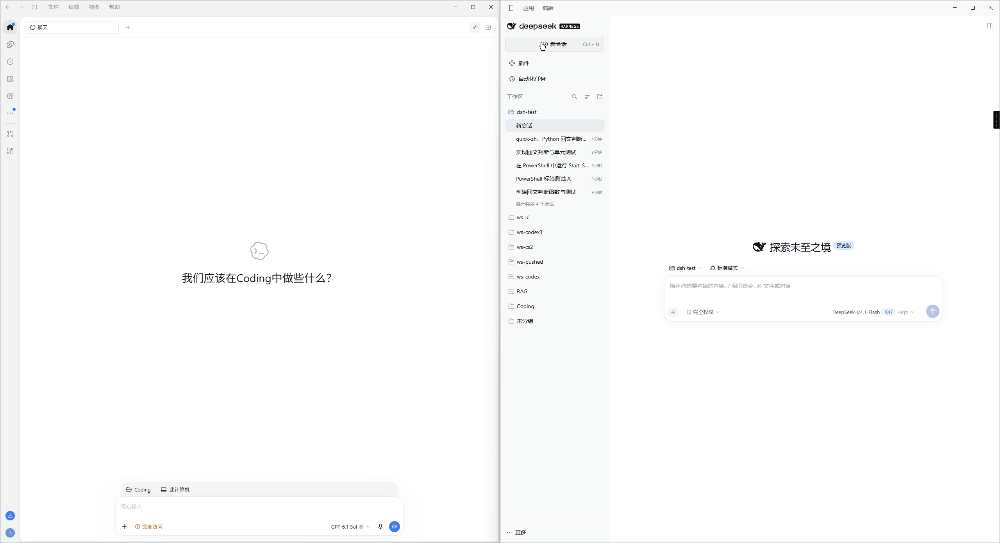
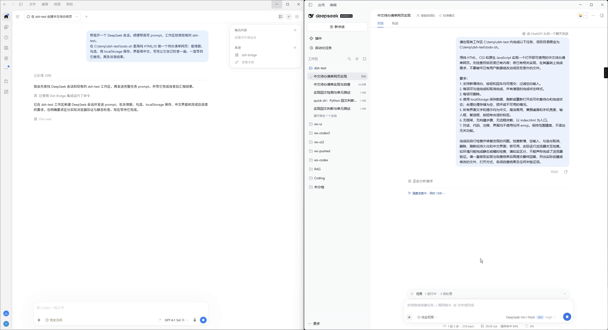
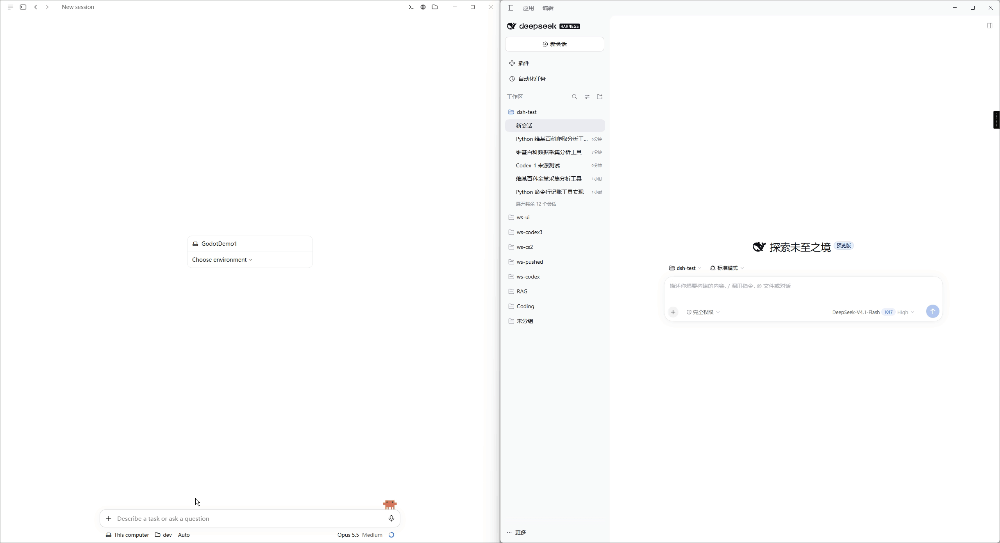
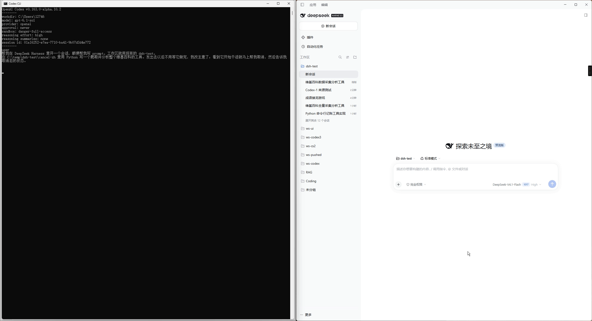
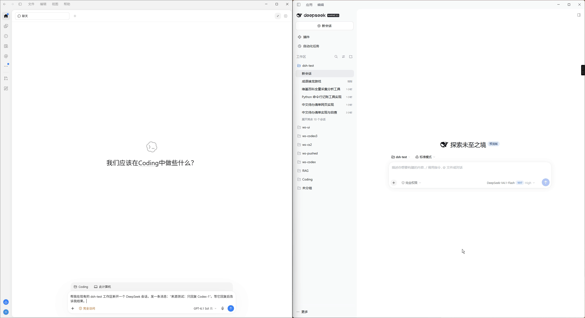

# dsh-bridge 演示

[English](demos.md) | 中文 · [返回 README](../README.zh-CN.md)

每个演示左边是发起任务的智能体，右边是 DeepSeek Harness。等待部分已加速。

## 用 Codex 派一个小任务

Codex 桌面版开一个 DeepSeek 会话，让它写回文函数和 3 个测试，跑完后报告结果。

  

## 长任务：等它做完再复核

让 DeepSeek 做一个待办清单网页，Codex 一直等到它做完，再复核结果。

  

## 在 Claude Code 里排队和插队

Claude Code 端完成新建、排队、插队。Claude 复核时自己发现 GBK 控制台下会崩溃的 bug，把修复要求整理好转给 DeepSeek，修完后再验证一遍。

  

## 在 Codex CLI 里取消

Codex CLI 发出任务后马上调用 `dsh_cancel` 取消，状态变为 `cancelled`。

  

## Codex 和 Claude 同一个对话

Codex 和 Claude 轮流往同一个 Harness 会话发消息。这是带左边 Codex 窗口的完整版。

  

